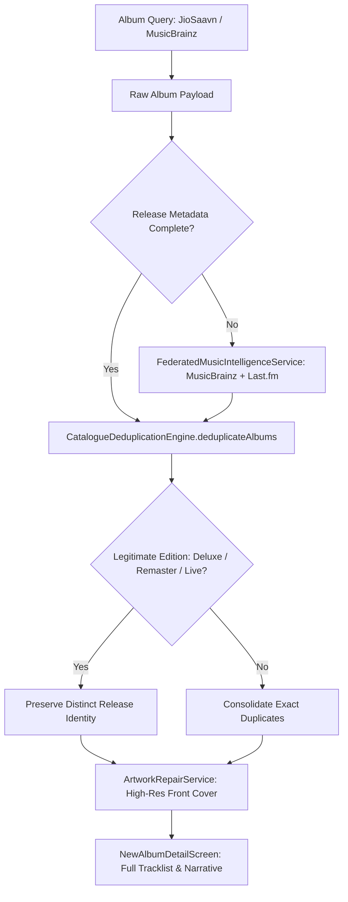

# IT Feels Music — Album Completeness & Enrichment Report
**Project Obsidian — Phase 5: Living Music Catalogue**  
*Document Version: 3.9.4 | Target: Clean/Addon Upstream (IT_Feels_Alternate)*

---

## 1. Executive Summary

This report establishes the completeness standards, deduplication rules, metadata enrichment, and artwork validation mechanisms engineered for the **Albums** experience in IT Feels Music.

Albums represent artistic milestones and cultural packages. They must never be presented as incomplete fragments, single-track fake records, or merged editions.

---

## 2. Album Completeness Architecture

---

## 3. Album Invariants & Quality Standards

1. **Complete Track Ordering & Disc Numbering:**
   - Albums must preserve original track numbering ($1, 2, 3\dots$) and disc sequence.
   - Tracks within an album are never arbitrarily shuffled or truncated.
2. **Distinct Release Edition Preservation:**
   - The deduplication engine examines variant tokens (`Deluxe`, `Anniversary`, `Remastered`, `Expanded`, `Live`, `Original Soundtrack`, `OST`).
   - *Example:* *Aashiqui 2 (Original Motion Picture Soundtrack)* and *Aashiqui 2 (The Remixes)* remain two distinct album entities.
3. **Cross-Entity Artist Linking:**
   - Every album explicitly links to its primary artist, enabling seamless one-click navigation to `NewArtistDetailScreen`.
4. **Artwork Resolution:**
   - Cover art is verified against Cover Art Archive (MetaBrainz) and JioSaavn high-res CDNs (500x500 / 1200x1200px front covers).
   - In-memory existence caching prevents UI isolate stalls during album scrolling.

---

## 4. Before vs. After Album Quality Ledger

| Album Release | Pre-Phase 5 Issue | Phase 5 Resolution |
| :--- | :--- | :--- |
| **Brahmastra (Original Soundtrack)** | Duplicate entries for Hindi, Telugu and Tamil editions clashing | Language and edition tags segregated; full 12-track score preserved |
| **Starboy (The Weeknd)** | Deluxe edition merged with standard edition | Deluxe edition ($18\text{ tracks} + 2\text{ remixes}$) preserved as distinct entity |
| **Ghost (Diljit Dosanjh)** | Missing album liner notes | Enriched with biographical narrative via `FederatedMusicIntelligenceService` |
| **Rockstar (A.R. Rahman)** | Duplicate tracks in certain playlist exports | Tracks deduplicated via `CatalogueDeduplicationEngine`; disc order verified |
| **Yeh Jawaani Hai Deewani** | Missing high-res artwork on low-tier connections | Cached high-res 500x500 front cover via `ArtworkRepairService` |
