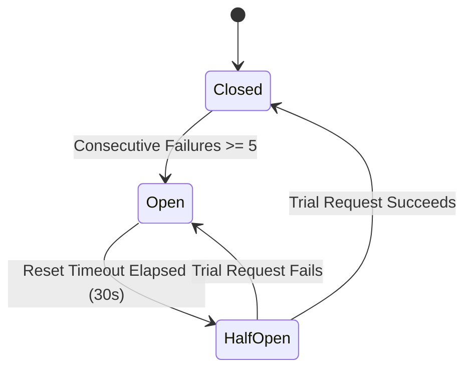

# Enterprise API Integration & Orchestration Architecture
**IT Feels Music — Enterprise Product Evolution 2026**
*Document Version: 1.0.0 | Status: Production Blueprint & Specification*

---

## 1. Architectural Overview

The Enterprise API Integration architecture in IT Feels Music is engineered to deliver zero-downtime, fault-tolerant, high-performance metadata enrichment and media streaming across diverse network topologies. 

External web services (MusicBrainz, Wikidata, Last.fm, JioSaavn, LRCLIB) have wildly different performance profiles, rate limits, and failure modes. The `EnterpriseApiOrchestrator` sits as a resilient mediator between UI/Domain consumers and network gateways, abstracting away network turbulence, throttling, and intermittent outages.

```text
+-----------------------------------------------------------------------------------+
|                        Domain / UI / Service Consumers                            |
+-----------------------------------------------------------------------------------+
                                         |
                                         v
+-----------------------------------------------------------------------------------+
|                           EnterpriseApiOrchestrator                               |
|                                                                                   |
|  +---------------------+   +-----------------------+   +-----------------------+  |
|  | SSRF Security Guard |-->| In-Flight Deduplicator|-->| Tiered Cache (L1/L2)  |  |
|  +---------------------+   +-----------------------+   +-----------------------+  |
|                                                                    |              |
|                                                            (Cache Miss / SWR)     |
|                                                                    v              |
|  +---------------------+   +-----------------------+   +-----------------------+  |
|  | Circuit Breaker     |<--| Rate Limiter (Tokens) |<--| Health Telemetry      |  |
|  +---------------------+   +-----------------------+   +-----------------------+  |
+-----------------------------------------------------------------------------------+
                                         |
                                         v
                +-------------------------------------------------+
                |      Adaptive Transport & Fallback Router       |
                |                                                 |
                |  [ Direct HTTPS ]  <--->  [ CF Worker Proxy ]   |
                +-------------------------------------------------+
                                         |
         +-------------------------------+-------------------------------+
         |               |               |               |               |
         v               v               v               v               v
    [ JioSaavn ]   [ MusicBrainz ]  [ Wikidata ]     [ Last.fm ]     [ LRCLIB ]
```

---

## 2. Core Orchestration Components

### 2.1 The Circuit Breaker Pattern (`CircuitBreaker`)

To prevent cascade failures and protect downstream providers from being hammered during outages, each external provider is protected by a dedicated stateful `CircuitBreaker`.



#### State Definitions & Transitions
1. **Closed (Healthy):**
   - Normal operation. Requests flow freely.
   - Any transient error increments the failure counter.
   - If failures reach `failureThreshold` (default: 5), state trips to **Open** and records `lastFailureTime`.
   - Any successful response resets the failure counter to 0.
2. **Open (Tripped):**
   - Requests fail-fast immediately with a `CircuitBreakerException` without touching the network.
   - Saves CPU cycles, battery, and prevents client timeouts.
   - Persists for `resetTimeout` (default: 30 seconds).
3. **Half-Open (Testing Recovery):**
   - After 30 seconds, the breaker enters Half-Open mode to allow a single trial probe through.
   - If the trial probe succeeds, the circuit immediately resets to **Closed**, and traffic resumes.
   - If the trial probe fails, the circuit resets back to **Open** for another 30 seconds.

### 2.2 Token-Bucket Rate Limiter (`TokenBucketRateLimiter`)

Third-party public APIs enforce strict concurrency and frequency limits. For example, MusicBrainz allows only 1 request per second and bans IP addresses that exceed this rate.

```dart
class TokenBucketRateLimiter {
  final double capacity;
  final double refillRatePerSecond;
  double _tokens;
  DateTime _lastRefill;

  Future<void> acquire() async {
    _refill();
    if (_tokens >= 1.0) {
      _tokens -= 1.0;
      return;
    }
    // Calculate exact delay needed to refill 1 token + micro jitter
    final delayMs = (((1.0 - _tokens) / refillRatePerSecond) * 1000).ceil();
    await Future.delayed(Duration(milliseconds: delayMs));
    _refill();
    _tokens = max(0.0, _tokens - 1.0);
  }
}
```

#### Rate Limit Profiles
- **MusicBrainz:** Capacity: 1.0, Refill: 1.0 token/s. Guarantees strict 1000ms separation between calls.
- **Last.fm:** Capacity: 5.0, Refill: 5.0 tokens/s. Allows small bursts with 200ms replenishment.
- **Wikidata:** Capacity: 3.0, Refill: 3.0 tokens/s.
- **Cover Art Archive:** Capacity: 5.0, Refill: 5.0 tokens/s.
- **Edge Proxy:** Capacity: 10.0, Refill: 10.0 tokens/s.

---

## 3. Tiered Caching Architecture (`TieredCacheManager`)

Network requests are expensive in latency, battery consumption, and rate quotas. The application uses a multi-tier caching hierarchy:

```text
[ Incoming Query ]
        |
        v
+---------------------------------------+
|  Tier 1: High-Speed Memory LRU Cache  | ---- Hit ----> Instant Return (< 1ms)
|  Capacity: 300 items | In-Process     |
+---------------------------------------+
        | Miss
        v
+---------------------------------------+
|  Tier 2: Persistent Disk Cache (JSON) | ---- Hit ----> Fast Return (< 15ms)
|  Storage: SharedPreferences / Isar DB |                + Populates Tier 1
+---------------------------------------+
        | Miss or Stale
        v
+---------------------------------------+
|  Tier 3: Network Execution via Proxy  | ---- New ----> Writes to Tier 1 + 2
+---------------------------------------+
```

### 3.1 Cache Freshness & TTL Policies
- **Authoritative Credits (MusicBrainz):** 7 Days. Credits rarely change after initial publishing.
- **Biographies & Wikidata:** 14 Days. Encyclopedic summaries are exceptionally stable.
- **Community Tags & Similar Artists (Last.fm):** 48 Hours. Reflects shifting listener patterns.
- **Synchronized Lyrics (.lrc):** 30 Days (Disk file persistence).
- **Home Feed & Chart Playlists:** 4 Hours with Stale-While-Revalidate (SWR).

### 3.2 Stale-While-Revalidate (SWR) Mechanism
When an item has expired past its TTL but remains within its grace period (e.g., 2x TTL):
1. The stale cached entry is returned immediately to the UI for instantaneous rendering.
2. An asynchronous background task fetches fresh data via `EnterpriseApiOrchestrator`.
3. When the fresh payload arrives, Tier 1 and Tier 2 caches update silently without interrupting the user.

---

## 4. Request Deduplication & In-Flight Coalescing

When multiple UI components simultaneously request metadata for the same entity (for instance, the desktop MiniPlayer, Now Playing backdrop, and Contextual Lyrics panel all loading the current song), issuing 3 duplicate HTTP calls would waste quota.

The `EnterpriseApiOrchestrator` implements in-flight deduplication:
```dart
final Map<String, Future<dynamic>> _inFlightRequests = {};

Future<T> executeWithDeduplication<T>(String requestKey, Future<T> Function() call) {
  if (_inFlightRequests.containsKey(requestKey)) {
    return _inFlightRequests[requestKey] as Future<T>;
  }
  
  final future = call().whenComplete(() {
    _inFlightRequests.remove(requestKey);
  });
  
  _inFlightRequests[requestKey] = future;
  return future;
}
```

---

## 5. Security & Network Hardening

### 5.1 Server-Side Request Forgery (SSRF) Prevention
Because the application processes URLs returned from diverse metadata providers and custom user-installed addons, strict URL sanitization is enforced:
- **Allowed Schemes:** `http` and `https` only. File, custom, or blob schemes are rejected.
- **Forbidden Hosts:** `localhost`, `127.0.0.1`, `0.0.0.0`, `::1`, `169.254.169.254` (cloud metadata), and internal RFC 1918 subnets (`10.0.0.0/8`, `172.16.0.0/12`, `192.168.0.0/16`).
- **Domain Whitelisting:** Untrusted outbound redirects are strictly validated before connection establishment.

### 5.2 Akamai TLS Reset Mitigation & Cloudflare Edge Failover
JioSaavn and related Indian music CDNs drop connections originating from desktop OS TLS fingerprints (Windows Schannel / Go TLS handshake). 
- All JioSaavn and image-fetching calls dynamically failover through the IT Feels Cloudflare Edge Worker:
  `https://it-feels-proxy.cleverfox687.workers.dev/api/v1/image-proxy?url={encoded_url}`
- If the proxy encounters high latency or errors, traffic safely falls back to standard HTTP client sockets.

---

## 6. Observability & Health Telemetry

The `ProviderHealthMonitor` continuously records health metrics for each registered provider:
- **Total Requests & Success Rate:** Measured over rolling 1-hour windows.
- **Latency Distribution:** Tracks average and 95th percentile response times in milliseconds.
- **Throttling Events:** Counts HTTP 429 status codes to tune rate limiter capacities automatically.
- **Circuit Breaker State:** Live reporting (`closed`, `open`, `halfOpen`).
- **User Observability:** Exposed in the New Experience under **Settings $\rightarrow$ Enterprise Diagnostics**.
