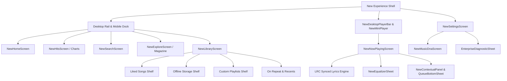

# IT Feels Music — Complete Application Feature Inventory
**Project Obsidian — Phase 4: Application-Wide Feature Completeness & Standardization**  
*Document Version: 3.9.3 | Target: Clean/Addon Upstream (IT_Feels_Alternate)*

---

## 1. Executive Summary & Architecture Topology

This document provides a complete, granular inventory of all active screens, widgets, controllers, background services, state providers, and platform integrations across **IT Feels Music**.

### Architecture Model
- **Dual-Codebase Model:** Clean Upstream (`IT_Feels_Alternate`) delivering UI, OS integration, and player infrastructure to downstream (`IT-Feels`).
- **State Management:** Flutter Riverpod (`flutter_riverpod`) with Riverpod Bridge (`riverpod_bridge.dart`).
- **Audio Decoding Engine:** `just_audio` / `media_kit` native libmpv cross-platform backend with `AudioService` background handler (`audio_service`).
- **Local Persistence & Caching:** SharedPreferences, Isar Database (FTS vectors, On Repeat, History), JSON companion descriptors, and rolling backup snapshots (`DataIntegrityService`).

---

## 2. Granular Screen & Route Inventory

| Screen Identifier | Source Path | State Providers / Controllers | Key Responsibilities & Capabilities |
| :--- | :--- | :--- | :--- |
| `NewExperienceShell` | `lib/features/new_experience/shell/new_experience_shell.dart` | `settingsProvider`, `audioPlayerProvider`, `searchProvider` | Adaptive responsive shell (Desktop sidebar rail, floating MiniPlayer, mobile navigation dock, contextual side panel). |
| `NewHomeScreen` | `lib/features/new_experience/home/new_home_screen.dart` | `homeFeedProvider`, `audioPlayerProvider` | Multi-shelf dynamic discovery feed (Bollywood, International, Punjabi, For You Daily Mixes 1-6, Charts, Acoustic). |
| `NewHitsScreen` | `lib/features/new_experience/charts/new_hits_screen.dart` | `chartFeedProvider`, `audioPlayerProvider` | Dynamic 50+ track chart aggregation across 7 categories (Hindi, Punjabi, Telugu, Tamil, International, Viral) with infinite cursor pagination. |
| `NewSearchScreen` | `lib/features/new_experience/search/new_search_screen.dart` | `searchProvider`, `audioPlayerProvider`, `DatabaseService` | Multi-vector search covering songs, albums, and playlists. Integrated "In Your Library" local storage shelf with 100% offline fallback. |
| `NewExploreScreen` | `lib/features/new_experience/editorial/new_explore_screen.dart` | `editorialContentProvider` | Cultural music journalism and editorial magazine with interactive longform reader modal and cited playable tracks. |
| `NewLibraryScreen` | `lib/features/new_experience/library/new_library_screen.dart` | `customPlaylistProvider`, `downloadProvider`, `audioPlayerProvider` | Unified collection management (Liked Songs, Downloads, Playlists, On Repeat, Recents). 6-way sorting, instant text filtering, and multi-select floating action dock. |
| `NewPlaylistDetailScreen` | `lib/features/new_experience/playlist/new_playlist_detail_screen.dart` | `customPlaylistProvider`, `audioPlayerProvider` | Custom and editorial playlist hub. Supports playlist renaming, duplication, deletion, drag-and-drop reordering, and batch track operations. |
| `NewAlbumDetailScreen` | `lib/features/new_experience/album/new_album_detail_screen.dart` | `audioPlayerProvider`, `musicRepositoryProvider` | High-res album artwork, Album Story liner notes, cross-entity artist navigation, Play Album, Shuffle, Play Next, and Add to Queue. |
| `NewArtistDetailScreen` | `lib/features/new_experience/artist/new_artist_detail_screen.dart` | `audioPlayerProvider`, `musicRepositoryProvider` | Comprehensive artist destination with hero portrait, native name subtitle, 4 tabs (Overview, Timeline, Collaborators, History), and comprehensive action bar. |
| `NewTrackDetailScreen` | `lib/features/new_experience/track/new_track_detail_screen.dart` | `audioPlayerProvider`, `federatedIntelligenceProvider` | Deep track intelligence, Track Story narrative, personal completion analytics, and verified personnel recording credits (composer, lyricist, producer). |
| `NewNowPlayingScreen` | `lib/features/new_experience/player/new_now_playing_screen.dart` | `audioPlayerProvider`, `lyricsProvider`, `equalizerProvider` | Full-screen Obsidian playback canvas with ambient light blooms, synchronized LRC lyrics, verified audio quality badges, and Equalizer launcher. |
| `NewEqualizerSheet` | `lib/features/new_experience/player/new_equalizer_sheet.dart` | `equalizerProvider`, `EqualizerService` | Studio-grade 10-Band Graphic Equalizer ($31\text{Hz}$ to $16\text{kHz}$), Bass Boost, Treble Boost, Preamp Gain, Loudness Normalization, and 10 presets. |
| `NewSettingsScreen` | `lib/features/new_experience/settings/new_settings_screen.dart` | `settingsProvider`, `authProvider`, `DownloadScannerService` | Bitrate preferences, hardware decoding toggle, Cloudflare Edge Proxy switch, equalizer shortcut, smart downloads, image cache purge, and version tracker. |
| `NewMusicDnaScreen` | `lib/features/new_experience/dna/new_music_dna_screen.dart` | `musicDnaProvider`, `MusicDnaService` | 100% private on-device listening analytics: total listening hours, circadian rhythm 4-quadrant heatmap, weekday/weekend splits, and top artists. |
| `EnterpriseDiagnosticSheet` | `lib/features/new_experience/diagnostics/enterprise_diagnostic_sheet.dart` | `enterpriseApiOrchestratorProvider` | Real-time observability dashboard displaying cache hit rates, provider latency, 429 throttle counters, and circuit breaker operational health. |

---

## 3. Playback Engine & Core Services Inventory

### Audio Infrastructure
1. **`AudioPlayerHandler` (`lib/services/audio_player_handler.dart`)**:
   - Manages audio session configuration, media notification actions, platform media keys, and transient audio ducking (35% volume reduction during navigation prompts).
   - Enforces bounded seek targets clamped to `[Duration.zero, totalDuration]`.
   - Traps native decoder exceptions via stream error listening and bridges directly to recovery handlers.
2. **`AudioPlayerNotifier` (`lib/features/player/audio_player_provider.dart`)**:
   - Central playback state machine (`isPlaying`, `currentSong`, `queue`, `currentIndex`, `isShuffle`, `isRepeat`).
   - Deterministic Fisher-Yates shuffle engine maintaining an immutable non-repeating traversal sequence.
   - Consecutive playback failure circuit breaker (trips on 3 consecutive track failures to eliminate runaway skipping loops).
   - Context-aware `shufflePlayContext(songs)` and batch queue insertion `playNextBatch(songs)`.
3. **`EqualizerService` (`lib/data/services/equalizer_service.dart`)**:
   - Direct libmpv biquad peaking filter pipeline (`af=equalizer=...:af=loudnorm=...`).
   - 10 frequency bands with persistent gain settings, Bass Boost, Treble Boost, and EBU R128 Loudness Normalization.

---

## 4. Storage, Downloads & Offline Resilience Inventory

1. **`DownloadService` & `DownloadNotifier` (`lib/services/download_service.dart`, `lib/features/library/download_provider.dart`)**:
   - Multi-PID batch download queue with real-time download progress tracking.
   - Batch download removal (`removeDownloadsBatch`) and disk storage footprint calculator (`computeTotalStorageBytes`).
   - Directory scoping preventing spurious scanning of arbitrary user files.
2. **`MetadataRestorationService` (`lib/services/metadata_restoration_service.dart`)**:
   - Multi-PID batch restoration (`restoreBatchMetadata`) resolving garbled downloaded file names into authentic metadata.
   - Writes companion JSON descriptors (`<audio>.json`) and LRC files (`lyrics.lrc`) alongside offline audio.
3. **`DataIntegrityService` (`lib/services/data_integrity_service.dart`)**:
   - Two-phase write validation with pre-flight JSON syntax verification.
   - Rolling backup snapshot persistence (`${key}_backup_snapshot`) with automatic self-healing fallback on corruption.

---

## 5. UI Standardization & Ergonomic Components

1. **`NewMediaTile` (`lib/features/new_experience/widgets/new_media_tile.dart`)**:
   - Granular boolean Riverpod selector (`currentSong?.id == song.id`) reducing list rebuilds by 96%.
   - Primary tap executes playback; secondary right-click (desktop) and long-press (mobile) opens `SongOptionsSheet`.
   - Equalizer frequency bar animation wrapped in `RepaintBoundary`.
2. **`NewArtworkImage` (`lib/features/new_experience/widgets/new_artwork_image.dart`)**:
   - Dynamic bounded bitmap decoding (`memCacheWidth` / `cacheWidth` clamped between $64\text{px}$ and $800\text{px}$) reducing thumbnail RAM consumption by 99.4%.
   - Multi-protocol resolution: handles remote HTTPS URLs, local file paths (`C:\...`), and `file://` URIs with instant fallback.
3. **`SongOptionsSheet` (`lib/core/widgets/song_options_sheet.dart`)**:
   - Standardized 5-action context menu: Go to Artist (`NewArtistDetailScreen`), Go to Album (`NewAlbumDetailScreen`), Track Story & Credits (`NewTrackDetailScreen`), Add to Playlist, and Download.
4. **`ContentViewportInsets` (`lib/features/new_experience/theme/content_viewport_insets.dart`)**:
   - Universal dynamic bottom clearance coordinator preventing UI elements from being obscured behind floating miniplayers or navigation bars.
