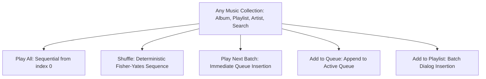

# IT Feels Music — Application Feature Standards & Guidelines
**Project Obsidian — Phase 4: Application-Wide Feature Completeness & Standardization**  
*Document Version: 3.9.3 | Target: Clean/Addon Upstream (IT_Feels_Alternate)*

---

## 1. Architectural Philosophy

Every feature in IT Feels Music must adhere to five non-negotiable principles:
1. **Music-First Focus:** Features must serve the discovery, playback, organization, and acoustic enjoyment of music.
2. **Zero Distractions:** No conversational AI bots, social feeds, comment sections, or artificial gamification streaks.
3. **Clean Upstream Independence:** All code belongs in `IT_Feels_Alternate`. Music sources are resolved dynamically via user-installed addons.
4. **Dual-Experience Preservation:** Classic UI (`lib/views/`) and New Experience (`lib/features/new_experience/`) coexist harmoniously without cross-contamination.
5. **Deterministic Stability:** State transitions must be predictable, bounded, and resilient to sudden network failures.

---

## 2. Standard Context & Action Capabilities

Every collection or track list across the application must implement the following standardized action capabilities:

### Action Bar Specification
When displaying an entity header (e.g. `NewAlbumDetailScreen`, `NewArtistDetailScreen`, `NewPlaylistDetailScreen`):
- **Play Button:** Primary accented button (Solid Violet or Cyan), $44\text{dp}$ height, icon `Icons.play_arrow_rounded`.
- **Shuffle Button:** Secondary outlined or soft-tinted button, icon `Icons.shuffle_rounded`. Always calls `ref.read(audioPlayerProvider.notifier).shufflePlayContext(songs)`.
- **Play Next Button:** Icon `Icons.playlist_play_rounded`, tooltip `'Play Next'`. Inserts entire batch immediately after currently playing track via `playNextBatch(songs)`.
- **Add to Queue Button:** Icon `Icons.queue_music_rounded`, tooltip `'Add to Queue'`. Appends tracks to queue via `addSongsToQueue(songs)`.
- **Add to Playlist Button:** Icon `Icons.playlist_add_rounded`, tooltip `'Add to Playlist'`. Prompts user to select or create a custom playlist.

---

## 3. Song Options Menu Standard (`SongOptionsSheet`)

Every track rendering in a list or grid must expose the standardized 5-point options sheet:
- **Trigger Methods:**
  - Desktop: Secondary right-click (`onSecondaryTap` on `NewMediaTile`).
  - Mobile: Long-press gesture (`onLongPress` on `NewMediaTile`) or dedicated trailing 3-dots icon (`Icons.more_vert_rounded`).
- **Standard Action Matrix:**
  1. **Go to Artist:** Navigates to `NewArtistDetailScreen(artistName: song.artist)`.
  2. **Go to Album:** Navigates to `NewAlbumDetailScreen(albumName: song.album)`.
  3. **Track Story & Credits:** Navigates to `NewTrackDetailScreen(song: song)`.
  4. **Add to Playlist:** Displays playlist selection modal.
  5. **Download / Remove Download:** Initiates download or deletes local file based on `isDownloaded(song.id)` state.

---

## 4. UI Layout & Viewport Clearance Standards

### Dynamic Bottom Insets
To prevent floating MiniPlayer bars, desktop player bars, or mobile navigation docks from obscuring content:
- **Rule:** Never use hardcoded bottom padding (e.g. `const SizedBox(height: 80)`).
- **Standard Implementation:**
  - In `CustomScrollView`: Use `ContentViewportInsets.sliverBottomSpacer(context, ref)`.
  - In `ListView` / `SingleChildScrollView`: Use `padding: EdgeInsets.only(bottom: ContentViewportInsets.bottom(context, ref))`.

### Glassmorphism & Obsidian Design Tokens
All UI elements must utilize centralized tokens from `NewExperienceTokens`:
- **Backgrounds:** `NewExperienceTokens.midnightSurface` (`#0D0D12` with specular border `Colors.white10`).
- **Accent Palette:**
  - Cyan: `#06B6D4` (Play states, badges, offline indicators).
  - Violet: `#8B5CF6` (Primary action buttons, active tabs).
  - Rose: `#F43F5E` (Favorites, heart icons).
- **Artwork Decoding:** Every image must route through `NewArtworkImage` with explicit `memCacheWidth` / `cacheWidth` constraints.

---

## 5. Offline Playback & Resilience Standards

1. **Deterministic Offline Playback:**
   - When playing downloaded tracks, `encryptedMediaUrl` contains the local filesystem path.
   - `AudioPlayerHandler` must never attempt remote CDN resolution when `File(song.encryptedMediaUrl).existsSync()` is true.
2. **Offline Companion Files:**
   - Every downloaded track saves `<audioBase>.json` (metadata descriptor) and `<audioBase>.lrc` (lyrics) in the same directory.
   - Offline scanning automatically imports these files with zero network dependency.
3. **Storage Footprint Accountability:**
   - Download views must calculate true physical disk usage via `computeTotalStorageBytes()` and display formatted footprints (e.g. `245.2 MB`).

---

## 6. Empty State Standards

Every collection, shelf, or search view must provide an informative empty state widget:
- **Visual:** Circular container with $5\%$ white opacity, specular border, and relevant category icon.
- **Title:** Clean, bold heading (e.g. `'No Downloaded Music Found'`).
- **Description:** 1-2 sentence explanation of why the view is empty and how the user can populate it.
- **Action Button:** Primary call-to-action button (e.g. `'Scan Disk Storage'`, `'+ Create Playlist'`, `'Explore Charts'`).

---

## 7. Deep Observability & Diagnostic Instrumentation Standards

Every subsystem, service, and architectural layer must adhere to the Project Obsidian Observability Standard:
1. **Central Logging Protocol:** All events, warnings, and errors must be dispatched through `ObservabilityService.instance`. Raw `print` or `debugPrint` statements in production logic are strictly prohibited.
2. **Trace & Correlation Invariants:** Multi-stage asynchronous lifecycles (such as playback request $\rightarrow$ source resolution $\rightarrow$ engine initialization $\rightarrow$ first audio) must generate or propagate a `correlationId` linking all events.
3. **Mandatory Privacy Scrubbing:** Zero logging of user passwords, email addresses, Bearer tokens, private Windows username paths (`C:\Users\[USER]\...`), or signed stream CDN tokens.
4. **Latency Telemetry & Percentiles:** Operations with latency targets must record execution durations via `PerformanceTelemetryTracker` to enable p50, p95, and p99 percentile tracking.
5. **Standardized Error Taxonomy:** Subsystem errors must emit structured codes (`ERR-PLBK-XXX`, `ERR-NET-XXX`, `ERR-DB-XXX`, etc.) with sanitized error messages and bounded stack traces.
6. **Diagnostic Dashboard Integration:** Operational telemetry and error explorer records must be viewable in `DiagnosticsDashboardScreen` and exportable in the unified diagnostic bundle via `DiagnosticExportService`.
