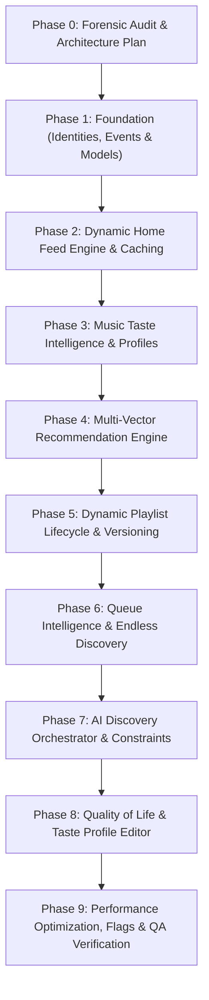

# Architecture Audit & Migration Plan
## IT Feels Music — Next-Generation Music Intelligence, Dynamic Feed & Recommendation Platform

**Version:** 3.7.0-ALPHA  
**Date:** November 2026  
**Status:** Approved for Implementation (Phase 0 Complete)  
**Target Branch:** `feature/next-gen-ui`  
**Dual-Codebase Classification:** Clean/Addon Upstream Repository (`IT_Feels_Alternate`)  

---

## 1. Executive Summary & Mission Objective

This architecture audit and migration blueprint establishes the technical foundation for transforming **IT Feels Music** into an intelligent, adaptive music streaming platform. 

The primary product objective is to provide a music streaming experience where:
1. Every user encounters an evolving, data-driven home experience reflecting their listening identity.
2. Recommendations introduce authentic, high-relevance discoveries rather than repeating identical tracks.
3. Playlists (Daily Mixes 1–6, Discover Weekly, Release Radar, On Repeat) possess stable identities, dynamic versioning, and preserve user modifications across scheduled refreshes.
4. AI functions as a constrained, validated orchestrator translating natural-language intent into validated catalog entries—never acting as an unverified source of truth for metadata or stream URLs.
5. Absolute preservation of the Classic UI and existing core playback services is strictly guaranteed.

---

## 2. Comprehensive Forensic Audit of Existing Codebase

### 2.1 Model Layer (`lib/data/models/`)
- **`Song` (`lib/data/models/song_model.dart`):**
  - **Strengths:** Holds essential playback metadata (`id`, `saavnId`, `title`, `artist`, `album`, `duration`, `coverArt`, `streamUrl`, `encryptedMediaUrl`, `hasLyrics`, `isFavorite`, `localFilePath`, `offlineStatus`). Backed by Isar schema `SongSchema` with full-text search indexing on `searchVector`.
  - **Weaknesses:** Lacks canonical identity decoupling. Ephemeral provider IDs (e.g., `saavn:12345`) are coupled directly with track identity. No provenance tracking, no ISRC support, no provider mapping array, and no explicit separation between metadata identity and playable source URL.
- **`Playlist` (`lib/data/models/song_model.dart`):**
  - **Strengths:** Clean constructor, support for `subtitle`, `songCount`, and `coverArt`.
  - **Weaknesses:** In-memory transient model without persistent lifecycle, versioning, or user edit diffing.
- **`CustomPlaylist` (`lib/data/models/custom_playlist.dart`):**
  - **Strengths:** Serialized to local JSON for user-created playlists.
  - **Weaknesses:** Flat list of songs without version history or refresh hooks.
- **`TrackRef` (`lib/data/models/track_ref.dart`):**
  - **Strengths:** Maps Spotify tracks to candidate references for playlist imports.
  - **Weaknesses:** Unconnected to the main playback or recommendation pipeline.

### 2.2 Persistence & Storage Layer
- **Isar Database (`lib/services/database_service.dart`):**
  - **Collections:** `SongSchema`, `CachedStreamSchema`, `CachedPaletteSchema`, `CachedLyricsSchema`, `CachedSearchSchema`.
  - **Strengths:** Ultra-fast, zero-copy, ACID-compliant local database running across Windows, Android, iOS, macOS, and Linux.
  - **Weaknesses:** No schema for listening events, taste profiles, dynamic feed snapshots, or playlist versions.
- **SharedPreferences (`lib/services/storage_service.dart`):**
  - Stores UI settings, offline download paths, user session flags, and a rudimentary 30-item `recentlyPlayed` list with raw artist play counts.

### 2.3 Catalog & Network Abstraction
- **`AddonManager` (`lib/data/services/addon_manager.dart`):**
  - Evaluates user plugins in QuickJS / Javascript runtimes, producing sanitized JSON for songs, albums, and playlists. Keeps the repository clean of hardcoded scraping code.
- **`MusicRepository` (`lib/data/repositories/music_repository.dart`):**
  - Dispatches catalogue queries via Cloudflare Edge proxy (`it-feels-proxy.cleverfox687.workers.dev`) and direct mirrors.
  - `getRecommendedSongs(Song)` currently queries `reco.getreco&pid=...` from JioSaavn or the Cloudflare Edge Worker.

### 2.4 Playback & Queue Architecture
- **`AudioEngineService` (`lib/data/services/audio_engine_service.dart`):**
  - Wraps `just_audio` player and `AudioPlayerHandler` (`audio_service` bridge) for OS lock-screen media controls.
- **`AudioPlayerNotifier` (`lib/features/player/audio_player_provider.dart`):**
  - Manages playback state, queue, active index, crossfade, shuffle, repeat, and volume.
  - **Deficiency:** `_fetchAutoplayRecommendations()` appends unranked Saavn recommendation tracks without deduplication tokens, queue priority segregation, or candidate validation.

### 2.5 Presentation Layer & Dual-Experience Routing
- **Dual Presentation Router (`lib/core/router/main_navigation_wrapper.dart`):**
  - Dispatches between Classic UI and `NewExperienceShell` based on `appExperienceProvider`.
- **`NewHomeScreen` (`lib/features/new_experience/home/new_home_screen.dart`):**
  - Currently renders a hardcoded list of sections (`Jump Back In`, `Made For You`, `Trending Hits`, `Featured Playlists`, `Essential Albums`).
  - **Deficiency:** Lacks a generic, data-driven feed renderer with typed section discriminated payloads.

### 2.6 AI Discovery Architecture
- **`AIService` (`lib/services/ai_service.dart`):**
  - Pluggable multi-provider architecture supporting Gemini, DeepSeek, OpenAI, Groq, and Mock.
- **`NewAIDiscoveryScreen` (`lib/features/new_experience/ai/new_ai_discovery_screen.dart`):**
  - Searches catalog text directly with `TrackValidationEngine` scoring. Needs formal structured constraint parsing (mood, genre, era, tempo).

---

## 3. Gap Analysis Matrix

| Requirement Area | Existing Capability | Required Transformation | Implementation Target |
| :--- | :--- | :--- | :--- |
| **Canonical Identity** | Ephemeral `id` prefixed with `saavn:` | Immutable `CanonicalTrack`, `ProviderTrackRef`, ISRC & provider provenance mapping | `lib/core/music_identity/` |
| **Listening Event System** | Flat play count increment in `logSong` | 17 structured events, offline queuing, duration/completion tracking, idempotent sync | `lib/core/intelligence/events/` |
| **Taste Profile** | Top 3 artist count map in SharedPreferences | Versioned `UserTasteProfile`, time-decayed affinity, negative exclusions, user editor | `lib/core/intelligence/taste/` |
| **Recommendation Engine** | Single-source `reco.getreco` proxy call | 11-step multi-source pipeline, configurable scoring, novelty control, artist diversification | `lib/core/intelligence/recommendations/` |
| **Dynamic Home Feed** | Hardcoded section composition in Home screens | Generic `HomeFeed` engine, 18 typed section models, cached snapshots, pagination | `lib/core/intelligence/feed/` |
| **Playlist Lifecycle** | Transient Daily Mixes & flat CustomPlaylists | Persistent `DynamicPlaylist`, versioning history, user override diffing (preserve edits) | `lib/core/intelligence/playlists/` |
| **Endless Discovery Queue** | Simple append to active queue on end | Explicit user queue vs Continuation queue separation, prefetching tokens, deduping | `lib/core/intelligence/queue/` |
| **AI Orchestrator** | Freeform text search in `NewAIDiscoveryScreen` | Constrained structured intent parsing (JSON schema), catalog reconciliation, deterministic fallbacks | `lib/core/intelligence/ai/` |

---

## 4. Target Modular Architecture

```
lib/
  core/
    music_identity/
      canonical_track.dart           <-- Canonical track model with provider refs & ISRC
      canonical_artist.dart          <-- Canonical artist model with genre tags
      canonical_album.dart           <-- Canonical album model
      canonical_playlist.dart        <-- Canonical playlist identity
      playback_candidate.dart        <-- Resolved playback stream with validity TTL
      music_identity_resolver.dart   <-- Identity resolution & deduplication engine

    intelligence/
      events/
        listening_event.dart         <-- 17 typed listening event contracts
        listening_event_buffer.dart  <-- Offline SQLite/Isar event queue with batching
        listening_event_processor.dart<-- Ingestion & mathematical signal processor

      taste/
        user_taste_profile.dart      <-- Multi-vector taste profile model
        taste_decay_engine.dart      <-- Exponential time-decay mathematical calculations
        taste_profile_service.dart   <-- Profile manager, updates & persistence

      recommendations/
        candidate_generator.dart     <-- Multi-source candidate pooling (artists, genres, moods)
        recommendation_scorer.dart   <-- Configurable heuristic multi-vector scoring formula
        recommendation_pipeline.dart <-- 11-step pipeline (filter, score, diversify, explain)

      feed/
        home_feed_models.dart        <-- Typed HomeFeed, HomeFeedSection (18 types), FeedItem
        home_feed_engine.dart        <-- Feed composition, section ordering, snapshot caching
        home_feed_provider.dart      <-- Reactive Riverpod feed state & pagination

      playlists/
        dynamic_playlist_models.dart <-- Versioned playlist contracts & generation recipes
        playlist_version_engine.dart <-- User override preservation (added/removed diffing)
        dynamic_playlist_service.dart<-- Scheduled & on-demand generator for Mixes 1-6, Discover Weekly

      queue/
        queue_intelligence_service.dart <-- Continuation engine, explicit priority, prefetch tokens

      ai/
        ai_discovery_orchestrator.dart <-- Structured intent parser, constraint validator & explainer

  features/
    new_experience/
      home/
        new_home_screen.dart         <-- Refactored to generic HomeFeedSection renderer
      settings/
        taste_profile_screen.dart    <-- User-facing taste profile editor & exclusions
```

---

## 5. Mathematical & Algorithmic Specifications

### 5.1 Listening Signal Formulation & Skip Classification
Listening events must not treat all skips as dislikes. We classify playback interactions into 4 engagement tiers:
1. **Immediate Skip ($t_{\text{play}} < 15\text{s}$ or completion $< 10\%$):** Weak negative signal (penalty: $-0.35$).
2. **Mid-Track Skip ($15\text{s} \le t_{\text{play}} \le 50\%$ duration):** Neutral / situational skip (penalty: $-0.05$).
3. **Late Skip ($50\% < t_{\text{play}} < 85\%$ duration):** Positive engagement (score: $+0.40$).
4. **Completion ($t_{\text{play}} \ge 85\%$ duration):** Strong positive signal (score: $+1.00$).
5. **Replay (same track repeated within session):** High positive affinity (score: $+1.75$).
6. **Explicit Actions:** Like/Favorite ($+2.50$), Add to Playlist ($+2.00$), Hide Track/Artist ($-10.00$, hard exclusion).

### 5.2 Time-Decayed Affinity Calculation
To prevent one unusual listening session from permanently skewing recommendations, affinity scores decay over time:

$$A_{\text{entity}}(t) = \sum_{i=1}^{N} w(e_i) \cdot e^{-\lambda (t - t_i)}$$

Where:
- $w(e_i)$ is the engagement weight of event $i$.
- $\lambda = \frac{\ln(2)}{t_{1/2}}$ is the decay constant with a half-life of $t_{1/2} = 21\text{ days}$ for short-term affinity and $t_{1/2} = 180\text{ days}$ for long-term affinity.
- $(t - t_i)$ is the elapsed time in days since event $i$.

### 5.3 Recommendation Scoring Equation
Every candidate track $T$ is scored across multiple vectors with configurable coefficients:

$$\text{Score}(T) = w_a A_{\text{artist}}(T) + w_g A_{\text{genre}}(T) + w_m M_{\text{mood}}(T) + w_r R_{\text{recency}}(T) + w_n N_{\text{novelty}}(T) - P_{\text{repetition}}(T) - P_{\text{exclusion}}(T)$$

Where default weights are:
- Artist Affinity Weight: $w_a = 0.35$
- Genre Affinity Weight: $w_g = 0.25$
- Mood Compatibility Weight: $w_m = 0.15$
- Recency / Release Relevance: $w_r = 0.10$
- Novelty / Discovery Bonus: $w_n = 0.15$
- Artist Repetition Penalty: $P_{\text{repetition}} = 0.50$ per prior track by same artist in the section.
- Hard Exclusion: If artist or track is in user's negative preference set, $\text{Score}(T) = -\infty$.

### 5.4 Dynamic Feed Section Types (18 Supported Types)
1. `featured` — Editorial hero banners & spotlight releases.
2. `quickPicks` — Immediate high-affinity tracks for quick playback.
3. `continueListening` — In-progress podcasts, albums, or radio stations.
4. `dailyMix` — Daily Mixes 1–6 with stable identity clusters.
5. `playlistCarousel` — Curated theme playlists.
6. `discoverWeekly` — Weekly personalized discovery collection.
7. `releaseRadar` — Fresh releases from followed and high-affinity artists.
8. `trackList` — Compact list of trending or recommended songs.
9. `artistCarousel` — Top and emerging artists to explore.
10. `albumCarousel` — Essential and recommended albums.
11. `moodGrid` — Contextual mood cards (Chill, Focus, Workout, Romance).
12. `genreCollection` — Interactive genre browse collections.
13. `songRadio` — Track-anchored endless discovery radio.
14. `personalizedDiscovery` — Underexplored gems matched to taste profile.
15. `forgottenFavorites` — Beloved tracks not listened to in $>60$ days.
16. `trending` — Real-time top charts and viral songs.
17. `aiPlaylistPrompt` — Natural language prompt entry capsule.
18. `recentlyAdded` — User's recent library additions.

---

## 6. Implementation Phases (Execution Order)



### Phase 1: Foundation
- **Deliverables:**
  - `CanonicalTrack`, `CanonicalArtist`, `CanonicalAlbum`, `ProviderTrackRef`, `PlaybackCandidate`.
  - Identity Resolver & Acoustic Matching via `TrackValidationEngine`.
  - Typed Feed Models (`HomeFeed`, `HomeFeedSection`, `FeedItem`).
  - Unit tests verifying identity resolution and deduplication.

### Phase 2: Dynamic Home Feed Engine
- **Deliverables:**
  - `HomeFeedEngine` with section composition, ordering, and stale-while-revalidate caching.
  - Refactored `NewHomeScreen` rendering typed sections through polymorphic section builders.
  - Backward compatibility: Classic UI remains 100% unaffected.

### Phase 3: Music Taste Intelligence
- **Deliverables:**
  - 17 typed listening event contracts and local Isar/memory buffer.
  - `TasteDecayEngine` calculating time-decayed artist and genre affinities.
  - `UserTasteProfile` state management with short-term vs long-term interests.

### Phase 4: Recommendation Engine
- **Deliverables:**
  - `CandidateGenerator` aggregating from favorites, similar artists, genres, and mood clusters.
  - `RecommendationScorer` implementing the multi-vector scoring equation.
  - Artist and album diversification filters with explanation metadata.

### Phase 5: Dynamic Playlist Lifecycle
- **Deliverables:**
  - Persistent, versioned playlist engine for Daily Mixes 1–6, Discover Weekly, and Release Radar.
  - User override preservation diffing: tracks added or removed by user survive scheduled refreshes.
  - Version history snapshots in local storage.

### Phase 6: Queue Intelligence & Endless Discovery
- **Deliverables:**
  - Queue continuation service maintaining explicit user queue priority.
  - Prefetching at threshold (e.g. 2 tracks remaining) using request generation tokens to eliminate async race conditions.

### Phase 7: AI Discovery Orchestrator
- **Deliverables:**
  - Natural-language query constraint extractor (structured JSON output schema).
  - Catalogue validator checking candidates against live repository before displaying.
  - Deterministic fallbacks when AI providers are rate-limited or offline.

### Phase 8: Quality of Life & Taste Profile Editor
- **Deliverables:**
  - User-facing Taste Profile Editor (`TasteProfileScreen`): adjust genre affinities, exclude artists, reset personalization.
  - Playlist version rollback viewer.

### Phase 9: Optimization, Feature Flags & QA Verification
- **Deliverables:**
  - Configuration feature flags (`dynamic_home_enabled`, `recommendation_engine_enabled`, `endless_playback_enabled`).
  - Full test suite execution across unit and widget tests.
  - Cross-platform verification on Windows desktop and mobile form factors.

---

## 7. Zero-Interruption Safety & Rollback Commitments

1. **Dual-Codebase Integrity:** All developments take place in `IT_Feels_Alternate`. No API scraping logic is hardcoded into the repo; dynamic add-ons and repository singletons are preserved.
2. **Classic UI Invariance:** Existing Classic UI screens (`HomeScreen`, `PlaylistDetailScreen`, `LibraryScreen`) continue using their existing providers without behavioral modification.
3. **Offline Resilience:** If offline or if Edge Workers encounter timeouts, the platform gracefully serves cached feed snapshots and local Isar database tracks.
4. **Playback Priority:** Feed background updates, analytics events, and recommendation prefetching execute on non-blocking microtasks to guarantee zero audio stutter or playback disruption.
