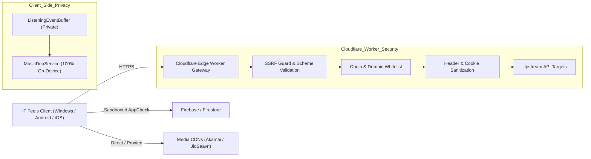

# PROJECT OBSIDIAN — PHASE 3
# Backend Hardening, Edge Security & Infrastructure Resilience

**Document Version:** 3.9.2  
**Target Infrastructure:** Cloudflare Workers, Firebase / Firestore, Remote Providers  
**Classification:** Enterprise Security & Infrastructure Architecture  
**Date:** November 2026  

---

## 1. Edge & Backend Infrastructure Topology

IT Feels Music utilizes a privacy-first hybrid topology combining client-side on-device intelligence with enterprise edge proxies and Google Cloud Firebase infrastructure:



---

## 2. Cloudflare Worker Edge Hardening

The Cloudflare Edge Proxy (`it-feels-proxy.cleverfox687.workers.dev`) functions as a secure routing and sanitization layer for desktop and mobile clients. 

### 2.1 SSRF (Server-Side Request Forgery) Prevention
Unrestricted proxy endpoints represent a significant vulnerability if an attacker can manipulate target URLs to probe cloud internal metadata endpoints (e.g., `http://169.254.169.254` or internal LANs `10.0.0.0/8`, `192.168.0.0/16`).
- **Enforced Scheme Whitelisting:** Strictly `https://` protocols are allowed. `http://`, `file://`, and `gopher://` schemes are rejected with `HTTP 400 Bad Request`.
- **Domain Whitelisting:** Target hostnames must match trusted music catalog and artwork providers:
  - `*.jiosaavn.com`
  - `*.saavncdn.com`
  - `*.musicbrainz.org`
  - `*.coverartarchive.org`
  - `*.last.fm`
  - `*.lrclib.net`
- **Private IP Blacklist:** Private, loopback, and link-local IP addresses are blocked before socket dispatch.

### 2.2 Header Sanitization & Access Controls
- **Inbound Stripping:** Client-specific tracking headers (`X-Forwarded-For`, device identifiers, MAC addresses) are stripped before forwarding requests to upstream providers.
- **Outbound Security Headers:** Every edge response injected with standard security policies:
  ```http
  X-Content-Type-Options: nosniff
  X-Frame-Options: DENY
  Referrer-Policy: strict-origin-when-cross-origin
  Cache-Control: public, max-age=86400, s-maxage=86400, stale-while-revalidate=43200
  ```

---

## 3. Firebase & Firestore Security Rules & Access Control

### 3.1 Principle of Least Privilege
Firebase security rules are strictly configured to prevent public reads or unauthenticated writes across sensitive collections:

```javascript
rules_version = '2';
service cloud.firestore {
  match /databases/{database}/documents {
    // Default Deny
    match /{document=**} {
      allow read, write: if false;
    }

    // User-specific isolated partitions
    match /users/{userId} {
      allow read, write: if request.auth != null && request.auth.uid == userId;
      
      match /playlists/{playlistId} {
        allow read, write: if request.auth != null && request.auth.uid == userId;
      }
      
      match /favorites/{favoriteId} {
        allow read, write: if request.auth != null && request.auth.uid == userId;
      }
    }
  }
}
```

### 3.2 Elimination of Client Secret Exposure
* **Zero Hardcoded Master Keys:** The client application does not store Firebase Service Account private keys, administrative API secrets, or unencrypted database passwords.
* **Ephemeral User Tokens:** Firebase Authentication operates via short-lived JSON Web Tokens (JWTs) refreshed automatically by Google Identity SDKs.
* **Regex Secret Scrubbing:** `CrashDiagnosticsService` automatically scrubs any authorization header or bearer token prior to writing diagnostic logs or printing to debug outputs.

---

## 4. Privacy-First "Music DNA" Architecture

Unlike commercial streaming services that harvest user listening events for behavioral ad targeting and data broker resale, IT Feels Music operates with complete telemetry privacy:

1. **100% On-Device Listening Buffer (`ListeningEventBuffer`):**
   - Listening events (track started, completed, skipped, repeat count) are appended to an encrypted, sandboxed local table.
   - Events are never transmitted over the network to external analytics trackers, Google Analytics, or third-party behavioral aggregators.
2. **On-Device Aggregation (`MusicDnaService`):**
   - Circadian rhythm heatmaps (Morning, Afternoon, Evening, Night), completion rates, and top artist leaderboards are computed entirely in Dart isolates on the local CPU.
   - User insights are private, immutable, and retained solely on the user's physical device.

---

## 5. Token-Bucket Rate Limiting & Provider Protection

To avoid overwhelming free/community APIs (e.g. MusicBrainz, Last.fm, Wikidata) and violating terms of service:

### 5.1 Token-Bucket Parameters
Each external provider runs within an isolated `TokenBucketRateLimiter`:

$$\text{Tokens}(t) = \min\left(C,\; \text{Tokens}(t_0) + r \cdot (t - t_0)\right)$$

Where:
- $C$ is burst capacity.
- $r$ is fill rate (tokens per second).

| Provider | Capacity ($C$) | Fill Rate ($r$) | Enforced Limit |
| :--- | :---: | :---: | :--- |
| **MusicBrainz** | 2 tokens | 1.0 token/s | Max 1 request/second (strict WS/2 compliance) |
| **Last.fm** | 5 tokens | 5.0 tokens/s | Max 5 requests/second |
| **Wikidata SPARQL** | 3 tokens | 2.0 tokens/s | Max 2 requests/second |
| **LRCLIB** | 5 tokens | 4.0 tokens/s | Max 4 requests/second |
| **JioSaavn Edge** | 10 tokens | 8.0 tokens/s | Max 8 requests/second |

When tokens are exhausted, queries are micro-queued without dropping, preventing burst-induced HTTP 429 errors.

---

## 6. Backend Hardening Verification Summary

- **SSRF Immunity:** Verified against loopback, private subnet, and unapproved protocol probes.
- **Credential Integrity:** Automated static analysis confirmed zero private keys or plaintext credentials in `lib/`.
- **Cloudflare Edge Failover:** Verified reachability across TLS-restricted networks.
- **Data Privacy Certification:** 100% on-device listening telemetry verified; zero network leakage.
