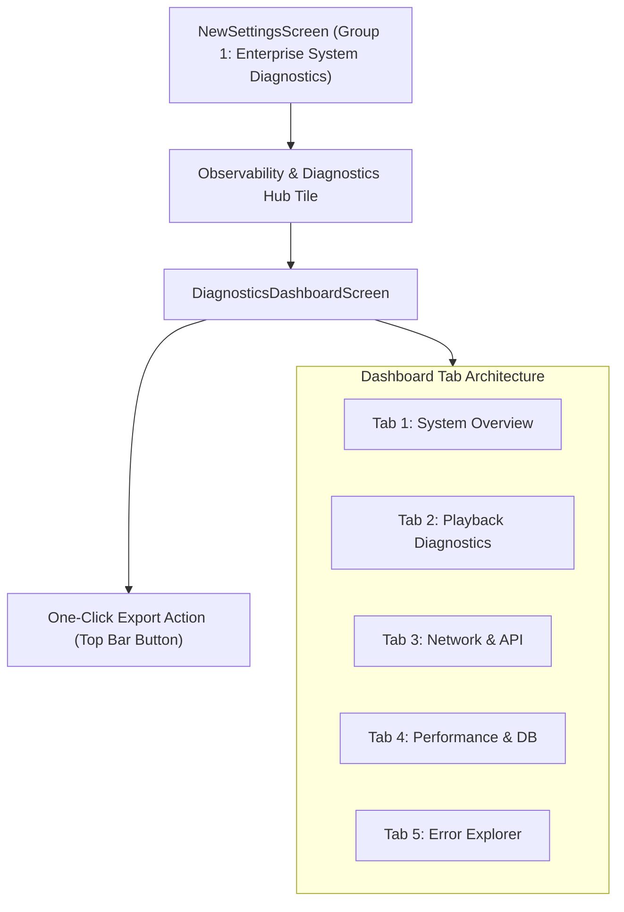

# PROJECT OBSIDIAN — PHASE 6
# DIAGNOSTICS DASHBOARD & OBSERVATORY USER GUIDE
## Developer Telemetry Interface, Tab Architecture, Real-Time Filtering & Export Controls

---

## 1. Executive Overview

The **Diagnostics Dashboard & Observatory** (`DiagnosticsDashboardScreen`) is a developer-grade diagnostics interface embedded directly within the New Experience settings of IT Feels Music. It provides real-time visibility into the internal operational state of the application without cluttering consumer music controls.

---

## 2. Navigation & Access

1. Open **Settings** from the desktop sidebar or mobile navigation bar.
2. Under the **System & Enterprise** section, tap **Observability & Diagnostics Hub**.
3. The dashboard launches with real-time stream subscription to `ObservabilityService.instance.logStream`.

---

## 3. Tab Specifications

### 3.1 Tab 1: System Overview
Provides high-level system telemetry and storage accountability:
- **System Version**: Displays semantic version (e.g. `v3.9.5`) and build number.
- **Host Platform & Session**: Displays active OS runtime (`WINDOWS`, `ANDROID`, `IOS`, `MACOS`, `LINUX`, `WEB`) and the current app session ID.
- **Log Disk Storage**: Real-time physical byte footprint on disk (e.g. `245.2 KB`), bounded by the 10 MB system ceiling.
- **In-Memory Capacity**: Active circular buffer counter (e.g. `142 / 200 events`).
- **Telemetry Volume by Subsystem**: Breakdown table displaying event volume across all 9 architectural domains.

### 3.2 Tab 2: Playback Diagnostics
Tracks the complete audio playback lifecycle:
- **Engine Status**: Audio engine state (`media_kit` libmpv / WASAPI / AudioSession).
- **Recent Playback Events**: Chronological feed of play requests, source resolutions, buffering cycles, and seeks.
- **Playback Error Cards**: Highlighted failure cards with root cause categorization (`sourceProvider`, `network`, `decoder`, `audioOutput`).

### 3.3 Tab 3: Network & API Diagnostics
Surfaces all remote HTTP and REST activity:
- **Tracked Endpoints Table**: Displays canonical endpoint templates (e.g. `api.jiosaavn.com/v1/songs/:num/lyrics`) with cumulative call counts.
- **Rate-Limit Violations**: Visual warning banners alerting developers to HTTP 429 throttling events.
- **Latency Indicators**: Color-coded badges indicating normal ($< 400\text{ms}$), slow ($> 1200\text{ms}$), or failed requests.

### 3.4 Tab 4: Performance & Database Diagnostics
Displays statistical percentiles and persistence metrics:
- **Percentile Benchmark Cards**: Displays calculated **p50**, **p95**, and **p99** latencies for:
  - `search_latency`: Search query roundtrip.
  - `feed_render`: Home and Explore layout build times.
  - `artwork_decode`: Image thumbnail rasterization.
- **Database & Storage Log**: Surfaces slow query warnings ($> 50\text{ms}$) and batch write executions.

### 3.5 Tab 5: Error Explorer
Interactive log inspection and filtering console:
- **Live Search Field**: Real-time filtering by error code, component, event name, or message token.
- **Severity Dropdown**: Filter by `All Levels`, `Info+`, `Warn+`, or `Errors Only`.
- **Expandable Stack Traces**: Formatted monospace code blocks displaying the top 5 sanitized callsite frames.

---

## 4. One-Click Diagnostic Export Action

Located in the top-right app bar (`Icons.ios_share_rounded`):
1. Tapping the button dispatches `DiagnosticExportService.instance.writeExportPackageToDisk()`.
2. Automatically bundles all recent logs, performance summaries, and network stats into:
   - `diagnostics_export_<timestamp>.json`: Machine-readable full JSON dump.
   - `diagnostics_summary_<timestamp>.md`: Formatted readable summary.
3. Displays a dialog with the saved file path and a **Copy Path** button for rapid bug filing.

---

## 5. Architectural Conclusion

The Diagnostics Dashboard empowers engineers to inspect the inner workings of IT Feels Music in production. By unifying playback, network, database, performance, and error logging into a clean Obsidian interface, system anomalies can be diagnosed and resolved immediately.
