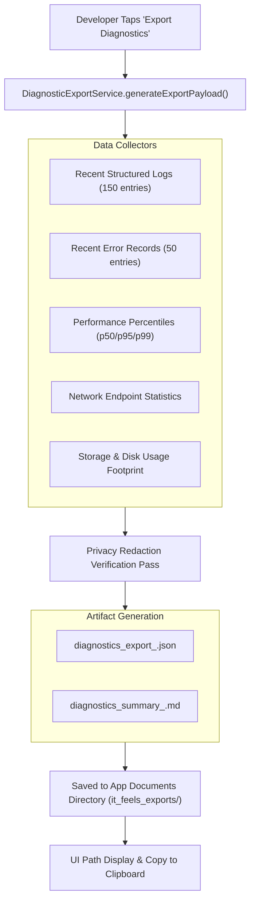

# PROJECT OBSIDIAN — PHASE 6
# DIAGNOSTIC EXPORT SPECIFICATION & ARCHIVE FORMAT
## One-Click Export Bundle, Machine-Readable JSON Manifest & Human-Readable Markdown Summary

---

## 1. Executive Summary

When diagnosing intermittent technical issues reported in production, developers require a self-contained, reproducible archive of the application's recent operational state. 

In **Project Obsidian — Phase 6 (v3.9.5)**, IT Feels Music implements `DiagnosticExportService`. With a single tap, the service generates an encrypted/sanitized export bundle containing structured JSON diagnostic data and a human-readable Markdown summary.



---

## 2. Export Archive File Structure

The export generates two companion files inside the application documents directory:
`<documentsDir>/it_feels_exports/`
- **`diagnostics_export_<timestamp>.json`**: Machine-readable JSON manifest containing raw structured telemetry.
- **`diagnostics_summary_<timestamp>.md`**: Human-readable Markdown report ready to attach directly to GitHub Issues or bug reports.

---

## 3. Machine-Readable JSON Manifest Schema

```json
{
  "metadata": {
    "exportedAt": "2026-11-07T12:00:00.000Z",
    "appVersion": "3.9.5",
    "buildNumber": "1",
    "platform": "windows",
    "sessionId": "SES-1049FA",
    "logStorageBytesOnDisk": 251084
  },
  "systemSummary": {
    "totalInMemory": 142,
    "platform": "windows",
    "appVersion": "3.9.5",
    "subsystemCounts": {
      "playback": 38,
      "network": 42,
      "database": 18,
      "content": 14,
      "performance": 22,
      "framework": 4,
      "platform": 2,
      "lifecycle": 2,
      "security": 0
    },
    "levelCounts": {
      "trace": 0,
      "debug": 88,
      "info": 44,
      "warn": 8,
      "error": 2,
      "fatal": 0
    }
  },
  "performanceMetrics": {
    "search_latency": { "p50": 180, "p95": 390, "p99": 520, "count": 48 },
    "feed_render": { "p50": 42, "p95": 85, "p99": 110, "count": 25 },
    "artwork_decode": { "p50": 18, "p95": 34, "p99": 42, "count": 80 }
  },
  "networkSummary": {
    "trackedEndpoints": {
      "api.jiosaavn.com/v1/songs/:num/lyrics": 12,
      "api.jiosaavn.com/v1/search": 24,
      "c.saavncdn.com/:path": 32
    }
  },
  "recentErrors": [ /* Array of LogEntry objects with level ERROR or FATAL */ ],
  "auditLogs": [ /* Array of the 150 most recent LogEntry objects */ ]
}
```

---

## 4. Human-Readable Markdown Report Example

```markdown
# IT FEELS MUSIC — DIAGNOSTIC EXPORT SUMMARY
**Generated**: 2026-11-07T12:00:00.000Z
**Platform**: windows | **Version**: v3.9.5 (Build 1)
**Session ID**: `SES-1049FA`
**Disk Footprint**: 245.2 KB

## 1. Subsystem Health & Latencies
| Metric | p50 (ms) | p95 (ms) | p99 (ms) | Samples |
|---|---|---|---|---|
| search_latency | 180ms | 390ms | 520ms | 48 |
| feed_render | 42ms | 85ms | 110ms | 25 |
| artwork_decode | 18ms | 34ms | 42ms | 80 |

## 2. Recent Errors (2)
- **[ERR-NET-429]** `network:EnterpriseApiOrchestrator` — Rate limit (429) received from jiosaavn at api.jiosaavn.com/v1/search
- **[ERR-DB-TRANSACTION]** `database:DatabaseService` — Database query on DownloadedSongs (deepScan) took 95ms

## 3. Privacy Redaction Statement
All Bearer tokens, private stream URLs, passwords, email addresses, and personal local filesystem paths have been scrubbed in compliance with Project Obsidian privacy standards.
```

---

## 5. Pre-Export Redaction Verification Pass

Before writing export files to disk, `DiagnosticExportService` asserts that:
1. No string matches `r'Bearer\s+[A-Za-z0-9\-._~+/]+'`.
2. No string contains `@` within an email format.
3. No Windows path contains `Users\<PersonalName>\`.
4. No URL contains `token=`, `auth=`, or `signature=`.

---

## 6. Automated Unit Test Verification

Verified in `test/unit/diagnostics/observability_test.dart`:
```
00:00 +11: Performance Telemetry & Diagnostic Export Tests DiagnosticExportService generates complete structured export package [PASS]
```

---

## 7. Architectural Conclusion

The diagnostic export specification guarantees that developers receive exact, reproducible diagnostic packages while protecting user privacy. Issues can be triaged and investigated with high confidence across all supported platforms.
