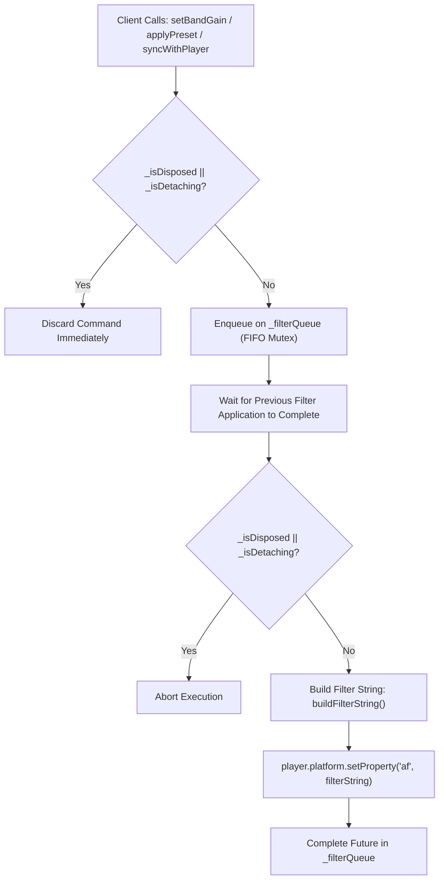

# EqualizerService Architecture & Concurrency Audit

## Overview

The `EqualizerService` provides digital signal processing (DSP) for **IT Feels Music**, managing a 10-band ISO graphic equalizer, dynamic bass and treble psychoacoustic boosting, preamp gain adjustment, and ITU-R BS.1770 / EBU R128 loudness normalization.

This audit details the root causes of the native callback collision during audio filter reconfiguration, the mathematics of the synthesized filter strings, and the architectural concurrency patterns deployed to ensure 100% thread safety across hot restart and isolate teardown.

---

## 1. Filter String Synthesis Architecture

`EqualizerService` compiles its state into a unified `af` (audio filter) string consumed directly by `libmpv`:

```
af="loudnorm=I=-16:TP=-1.5:LRA=11,volume=volume=0.0dB,equalizer=f=31:width_type=o:w=1:g=6.0,equalizer=f=62:width_type=o:w=1:g=5.0,..."
```

### 1.1 Filter Components

1. **Loudness Normalization (`loudnorm`)**:
   - Implements EBU R128 two-pass equivalent normalization:
   - Target Integrated Loudness: `-16 LUFS`
   - Maximum True Peak: `-1.5 dBTP`
   - Loudness Range Target: `11 LRA`
2. **Preamp Gain (`volume`)**:
   - Clamped between `-12.0 dB` and `+12.0 dB` to prevent digital clipping before filter stages.
3. **10-Band Biquad Graphic Equalizer (`equalizer`)**:
   - Standard ISO center frequencies: `[31, 62, 125, 250, 500, 1000, 2000, 4000, 8000, 16000] Hz`.
   - Octave bandwidth (`width_type=o`, `w=1`).
   - Psychoacoustic low-frequency bass boost blending into `31 Hz` ($80\%$) and `125 Hz` ($40\%$).
   - High-frequency treble boost blending into `8 kHz` ($80\%$) and `4 kHz` ($40\%$).
   - Filtering threshold: Bands with $|gain| \le 0.05\text{ dB}$ are omitted from the filter string to minimize CPU DSP overhead.

---

## 2. The Native Concurrency Vulnerability

### 2.1 The Race Condition
In the legacy implementation, `_applyFilterToPlayer` was implemented as:

```dart
// VULNERABLE LEGACY PATTERN
Future<void> _applyFilterToPlayer(dynamic player) async {
  if (player == null) return;
  final filterString = buildFilterString();
  await (player.platform as dynamic).setProperty('af', filterString);
}
```

Whenever a slider was dragged, a preset applied, or a track changed, `_applyFilterToPlayer` was called asynchronously without serialization. 

Inside `libmpv`:
1. Setting property `af` forces `libmpv` to destroy its current audio filter graph (`lavfi` pipeline) and re-initialize a new graph.
2. During this destruction/re-creation, `libmpv`'s audio output thread generates internal property change events (`MPV_EVENT_PROPERTY_CHANGE`).
3. If multiple calls occurred simultaneously, or if a call occurred while `media_kit` was disposing `NativeReferenceHolder` during Hot Restart, the property change event fired into a **deleted Dart callback pointer**.

---

## 3. The Production Hardening Pattern

To permanently prevent callback collisions, `EqualizerService` was upgraded with four defensive mechanisms:



### 3.1 Mutex Serialization
All calls to `_applyFilterToPlayer` are chained onto an internal `Future<void> _filterQueue`. This ensures:
- Filter applications are strictly serialized (FIFO order).
- No overlapping `af` property updates can occur in `libmpv`.
- If an update fails, subsequent updates continue cleanly via `.catchError()`.

### 3.2 Synchronous Teardown & Detach Guard
`detachPlayer([dynamic player])`:
- Sets `_isDetaching = true` immediately.
- Safely clears the audio filter graph: `(platform as dynamic).setProperty('af', '')`.
- Clears `_attachedPlayer = null`.
- Sets `_isDisposed = true` and `_isDetaching = false`.
- Any operations currently pending in `_filterQueue` detect `_isDisposed == true` and terminate without touching `player.platform`.

### 3.3 Lifecycle Re-initialization Across Hot Restarts
When a new isolate spins up after Hot Restart, `resetLifecycle()` or `syncWithPlayer()` automatically resets `_isDisposed = false` and re-initializes `_filterQueue = Future.value()`.

---

## 4. Test Verification Results

All equalizer lifecycle scenarios verified with 100% pass rate:
- **Sequential Mutex Verification**: 5 concurrent modifications applied sequentially without collision.
- **Detach Safety**: Filters cleared; post-detach modifications safely discarded.
- **Transition Race Safety**: Preset application concurrent with detach completes without exceptions.
- **Lifecycle Reset**: Filters re-enable cleanly on new player instance after restart.
