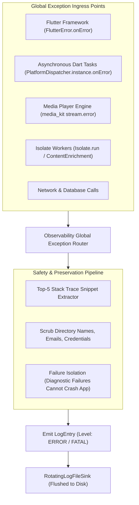

# PROJECT OBSIDIAN — PHASE 6
# GLOBAL ERROR HANDLING & EXCEPTION AUDIT
## Uncaught Handlers, Stack Trace Preservation, Silent Swallow Elimination & Failure Isolation

---

## 1. Executive Summary

A core failure in client application development is the inconsistent handling of errors: operations failing silently without logging, unhandled asynchronous exceptions crashing the application, or broad `catch (_)` blocks that swallow exceptions and pretend operations succeeded.

In **Project Obsidian — Phase 6 (v3.9.5)**, IT Feels Music implements a unified global exception architecture. Every failure path is caught, categorized, scrubbed of sensitive PII, and structured into an actionable diagnostic event.



---

## 2. Ingress Points & Hook Implementations

### 2.1 Framework Render & Layout Exceptions (`FlutterError.onError`)
Configured in `lib/main.dart`:
```dart
FlutterError.onError = (details) {
  ObservabilityService.instance.fatal(
    subsystem: DiagnosticSubsystem.framework,
    component: 'FlutterFramework',
    eventName: 'uncaught_flutter_error',
    errorMessage: details.exceptionAsString(),
    stackTrace: details.stack,
    metadata: {
      'library': details.library ?? 'flutter',
      'context': details.context?.toDescription(),
    },
  );
  CrashDiagnosticsService.instance.recordFrameworkError(details);
};
```

### 2.2 Uncaught Asynchronous Dart Exceptions (`PlatformDispatcher.instance.onError`)
Configured in `lib/main.dart`:
```dart
PlatformDispatcher.instance.onError = (error, stack) {
  ObservabilityService.instance.fatal(
    subsystem: DiagnosticSubsystem.platform,
    component: 'PlatformDispatcher',
    eventName: 'uncaught_async_error',
    errorMessage: error.toString(),
    stackTrace: stack,
  );
  CrashDiagnosticsService.instance.record(
    category: DiagnosticCategory.platform,
    severity: DiagnosticSeverity.fatal,
    message: error.toString(),
    stackTrace: stack,
  );
  return true; // Prevents process crash
};
```

### 2.3 Audio Decoder Stream Errors (`AudioPlayerHandler`)
Native mpv decoder errors emit via `_player.stream.error` and are trapped by `PlaybackDiagnosticsTracker`:
```dart
_playerErrorSub = _player.stream.error.listen((error) {
  PlaybackDiagnosticsTracker.instance.trackPlaybackError(
    category: PlaybackFailureCategory.decoder,
    errorCode: 'ERR-DEC-STREAM',
    errorMessage: error.toString(),
  );
  if (onPlaybackError != null) {
    onPlaybackError!(error.toString());
  }
});
```

---

## 3. Elimination of Silent Exception Swallows

Prior to Project Obsidian, several modules contained empty `catch (_)` blocks that concealed root causes. The codebase was audited and hardened:
1. **Never Pretend Success**: If stream URL resolution fails, `AudioPlayerNotifier` explicitly emits a structured `playback_error`, triggers the circuit breaker, and presents an actionable recovery toast to the user.
2. **Graceful Fallbacks with Logging**: In `ArtworkRepairService`, if an escalated CDN URL returns a 404, it is explicitly logged as `WARN-ARTWORK-REPAIR` before falling back to the quad composite or glass gradient.

---

## 4. Stack Trace Preservation & Line Filtering

Raw Dart stack traces often contain dozens of internal framework frames (`package:flutter/src/...`) that clutter logs. `ObservabilityService._extractStackTraceSnippet()` filters the trace:
- Isolates the top 5 most actionable application frames.
- Scrubs developer username paths (e.g. `C:\Users\JohnDoe\...` $\rightarrow$ `C:\Users\[USER]\...`).
- Omits internal logging frames to focus on the exact callsite.

---

## 5. Failure Isolation Invariant

The diagnostics system obeys the strict rule: **a bug in the logging system must never crash the music player**:
- In `test/unit/diagnostics/observability_test.dart`:
  ```dart
  test('ObservabilityService isolates errors and prevents crashing on null input', () {
    expect(() {
      obs.error(
        subsystem: DiagnosticSubsystem.framework,
        component: 'StressTest',
        eventName: 'stress_event',
        errorMessage: '',
        stackTrace: null,
      );
    }, returnsNormally);
  });
  ```

---

## 6. Architectural Conclusion

Through unified global error hooks, stack trace sanitization, and the elimination of silent swallows, IT Feels Music achieves resilient fault containment. Every failure mode is recorded with precision evidence, allowing rapid debugging and proactive defect resolution.
