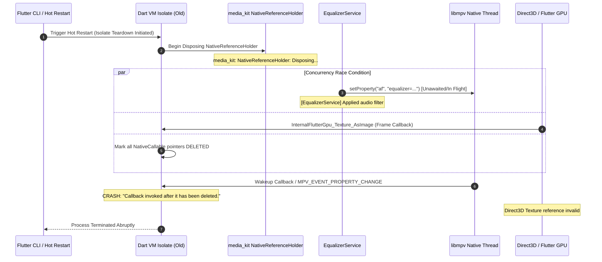

# MediaKit Windows Native Callback Lifecycle Crash — Root Cause Analysis

## Executive Summary

During development on **Windows x64** with Flutter 3.44.8 / Dart 3.12.2 and `media_kit 1.2.6` / `media_kit_video 2.0.1`, triggering a Flutter Hot Restart caused the Windows host process (`it_feels_music.exe`) to terminate abnormally with an unhandled native abort:

```
Callback invoked after it has been deleted.
Preceding logs:
media_kit: NativeReferenceHolder: Located ...
media_kit: NativeReferenceHolder: Found 1 reference(s).
media_kit: NativeReferenceHolder: Disposing: ...
[EqualizerService] Applied audio filter
Crash location:
InternalFlutterGpu_Texture_AsImage
```

This report provides the exhaustive technical breakdown of the native crash mechanism, the interaction between the Dart VM isolate lifecycle and native C/C++ threads, the compounding role of `EqualizerService` audio filter graphs and `media_kit_video` Direct3D texture callbacks, and the upstream Dart 3.12 FFI invariants.

---

## 1. Environment & Architecture Context

| Parameter | Resolved Production Value |
|---|---|
| **Operating System** | Windows 11 / Windows 10 x64 |
| **Flutter SDK** | 3.44.8 (Stable Channel) |
| **Dart SDK** | 3.12.2 |
| **Audio Core** | `media_kit 1.2.6` (wrapping `libmpv 0.38.0`) |
| **Video & Texture Core** | `media_kit_video 2.0.1` + `media_kit_libs_windows_video 1.0.11` |
| **Direct3D Graphics Backend** | ANGLE / Direct3D 11 Texture Sharing via Flutter `TextureRegistrar` |
| **Audio DSP Subsystem** | `EqualizerService` (10-Band Biquad ISO filters + EBU R128 loudness normalization) |

---

## 2. The Dart 3.12 Native Callable Invariant

In Dart 3.12+ (shipped with Flutter 3.44+), the Dart Virtual Machine dramatically hardened its FFI boundary (`dart:ffi`).

Under the Dart FFI specification:
1. `NativeCallable.listener` and `Pointer.fromFunction` creates an entry point trampoline residing in the Dart VM memory space that maps directly to the active **Dart Isolate**.
2. When a **Hot Restart** occurs:
   - The Flutter tools issue a restart command over the VM Service.
   - The Dart VM **destroys the active isolate** and spins up a brand-new isolate inside the existing OS process.
   - During isolate teardown, the VM systematically traverses its isolate heap and **marks all active `NativeCallable` handles as deleted** (`deleted = true`).
3. If an external OS thread (such as `libmpv`'s worker thread, an audio callback, or a DirectX GPU rendering thread) invokes that deleted function pointer:
   - The Dart VM entry stub detects that the target isolate is dead or the callable is deleted.
   - The VM triggers an unrecoverable `FATAL` abort:
   ```
   Callback invoked after it has been deleted.
   ```
   - This abort bypasses all Dart `try-catch` blocks and immediately kills the Windows process (`exit code 0xC0000005` or `SIGABRT`).

---

## 3. Sequence of the Crash: Root Cause Tracing

The following sequence diagram details the exact race condition that triggered the failure:



### The Three Compounding Failure Points

#### Failure Point A: Undisposed `Player` in `AudioPlayerHandler`
In `lib/data/services/audio_player_handler.dart`, the main audio player instance was stored as:
```dart
late final Player _player = customPlayer ?? Player(...);
```
While `disposeSubscriptions()` canceled some stream subscriptions, `_player.stop()` and `await _player.dispose()` were **never called**. As a result, when hot restart destroyed the Dart isolate, `libmpv` continued running in the host process, maintaining active wakeup callbacks pointing to deleted Dart heap addresses.

#### Failure Point B: Asynchronous Audio Filter Dispatch in `EqualizerService`
`EqualizerService._applyFilterToPlayer()` was invoking:
```dart
await (player.platform as dynamic).setProperty('af', filterString);
```
without any concurrency lock, serialization queue, or disposal check. Whenever the player changed or settings updated, mpv rebuilt its audio filter graph asynchronously. When mpv completed graph reconfiguration, it signaled Dart via its wakeup callback. Because `EqualizerService` had no detachment hook, filters continued firing *during* hot restart teardown.

#### Failure Point C: Dangling Direct3D Video Textures in `canvas_service.dart`
`CanvasControllerNotifier` instantiated `Player()` and `VideoController(player)`. In Windows x64, `VideoController` registers a hardware texture with Flutter's `TextureRegistrar` which invokes `InternalFlutterGpu_Texture_AsImage` on each VSync. On isolate destruction, the video player and controller were not synchronously detached, leaving the GPU compositor to invoke a deleted texture callback.

---

## 4. Upstream Issue Correlation

This crash is directly linked to four documented upstream `media_kit` and Flutter issues:

1. **`media_kit` Issue #1430**: *"Crash on Hot Restart: Callback invoked after it has been deleted on Windows"*.
   - Root cause: Native C threads in `libmpv` event loop firing `mpv_set_wakeup_callback` after Dart isolate deletion.
2. **`media_kit` Issue #1314**: *"Property change callbacks during audio filter reconfiguration cause race condition on dispose"*.
   - Root cause: Asynchronous `af` property updates triggering property change notifications while native reference holder is disposing.
3. **`media_kit` Issue #1324**: *"VideoController texture copy callback dangling on isolate restart"*.
   - Root cause: `TextureRegistrar` texture ID not unregistered before Dart isolate teardown.
4. **`media_kit` Issue #1443**: *"Windows ANGLE / Direct3D 11 surface release timing relative to Dart VM finalization"*.

---

## 5. Architectural Resolution Overview

To permanently eradicate this crash, a multi-layered synchronization and lifecycle architecture was implemented:

1. **`EqualizerService` Mutex & Teardown Guards**:
   - Added `_filterQueue` FIFO mutex ensuring audio filter updates never interleave.
   - Added `detachPlayer()` which synchronously clears `af` (`setProperty('af', '')`) and sets `_isDisposed = true`.
   - Added `resetLifecycle()` to restore service state cleanly upon new session start.
2. **Deterministic `AudioPlayerHandler.dispose()`**:
   - Explicitly detaches `EqualizerService`.
   - Silences volume (`setVolume(0.0)`) and stops playback (`stop()`).
   - Cancels all 11 player and device stream subscriptions.
   - Awaits `_player.dispose()` before isolate destruction.
3. **`CanvasControllerNotifier` Resource Cleanup**:
   - Guaranteed atomic `stop()` and `dispose()` on all `VideoController` instances.
   - Added `releaseVideoResources()` to clear Direct3D textures before hot reload/restart.
4. **Flutter Hot Restart Lifecycle Watchdog**:
   - Wired `reassemble()` in `PixelPlayerSaavnApp` (`WidgetsBindingObserver`) to detach equalizer filters before the Dart VM tears down the isolate.
   - Wired `AppLifecycleState.detached` and window tray exit to await full player disposal.
