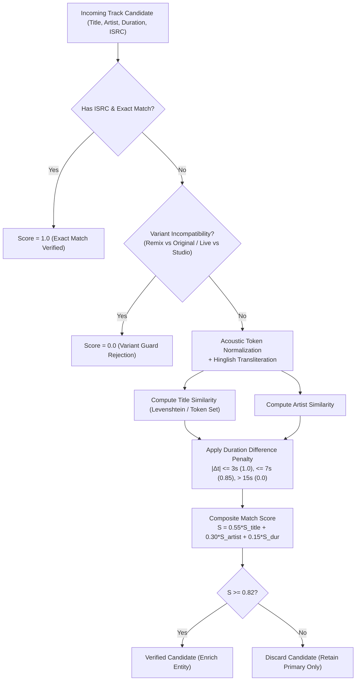

# Canonical Music Entity Schema & Resolution Ontology
**IT Feels Music — Enterprise Product Evolution 2026**
*Document Version: 1.0.0 | Status: Production Data Contract*

---

## 1. Architectural Philosophy

In an enterprise federated ecosystem, upstream providers possess conflicting schemas, disparate naming conventions, and inconsistent identifiers. IT Feels Music enforces a strict **Canonical Entity Separation**:
1. Ephemeral provider IDs (e.g. JioSaavn PID `15QJDYRz`, Spotify URI `spotify:track:...`, YouTube ID `v=dQw4w9WgXcQ`) are never used as internal primary keys.
2. Domain entities are converted into immutable **Canonical Models** governed by deterministic canonical IDs and acoustic fingerprint hashes.
3. Every enriched field carries a `DataProvenance` envelope recording its origin, confidence score, attribution, and license.

---

## 2. Core Entity Schemas

### 2.1 Canonical Track (`CanonicalTrack`)

The atomic unit of musical recording, playback candidate resolution, and credit tracking.

```dart
class CanonicalTrack {
  final String id;                           // Deterministic hash: track:normTitle:normArtist
  final String title;                        // Cleaned display title (e.g. "Kesariya")
  final String mainArtist;                   // Primary credited artist (e.g. "Arijit Singh")
  final List<String> featuredArtists;        // Collaborators/features (e.g. ["Pritam", "Amitabh Bhattacharya"])
  final String album;                        // Containing album name (e.g. "Brahmastra")
  final String? albumId;                     // Canonical album entity reference
  final Duration duration;                   // Verified audio duration
  final String? isrc;                        // International Standard Recording Code
  final DateTime? releaseDate;               // Earliest verified release date
  final String? language;                    // Language code (e.g. "hi", "en", "pa")
  final bool isExplicit;                     // Content advisory flag
  
  // Enriched Intelligence
  final String? trackStory;                  // Curated contextual background and history
  final String? composer;                    // Verified music composer(s)
  final String? lyricist;                    // Verified lyricist(s)
  final String? producer;                    // Music producer / audio arranger
  final String? recordLabel;                 // Publishing label (e.g. "Sony Music Entertainment")
  final List<CanonicalContributor> credits;  // Full recording personnel credits
  final List<String> alternateVersions;      // IDs of linked remixes, live takes, or unplugged versions
  
  // Playback & Federation Bindings
  final List<ProviderTrackRef> providerRefs; // Linked stream resolvers (JioSaavn, Addons, Local)
  final DataProvenance provenance;           // Origin tracking, confidence & attribution
}
```

### 2.2 Canonical Artist (`CanonicalArtist`)

Comprehensive artist profile unifying discography, collaborative graphs, and listening history.

```dart
class CanonicalArtist {
  final String id;                              // Deterministic hash: artist:normArtist
  final String name;                            // Romanized primary name (e.g. "A.R. Rahman")
  final Map<String, String> nativeNames;        // Language script mappings (e.g. {"ta": "ஏ. ஆர். ரகுமான்", "hi": "ए. आर. रहमान"})
  final String? country;                        // ISO country code or region (e.g. "IN")
  final String? activeYears;                    // Verified career span (e.g. "1992–present")
  final String? biography;                      // Grounded encyclopedic biography
  final List<String> primaryGenres;             // Curated main genres
  final List<String> associatedGenres;          // Folksonomy and community tags
  final String? imageUrl;                       // High-resolution portrait URL
  final String? backdropUrl;                    // Panoramic stage/backdrop banner
  
  // Graph Intelligence
  final List<CareerMilestone> timeline;         // Chronological career milestones & award releases
  final List<String> collaborators;             // Verified co-credited artists on recordings
  final List<String> influences;                // Cited musical inspirations
  final List<String> relatedArtists;            // Acoustically or statistically similar artists
  
  // Private On-Device Relationship (Computed Locally)
  final ArtistUserRelationship? userRelationship;
  final DataProvenance provenance;
}

class CareerMilestone {
  final int year;
  final String title;
  final String description;
  final String? releaseRef;
}

class ArtistUserRelationship {
  final int totalPlays;
  final int totalListeningMinutes;
  final List<String> topPlayedSongs;
  final DateTime? firstRecordedPlay;
  final DateTime? lastRecordedPlay;
}
```

### 2.3 Canonical Album (`CanonicalAlbum`)

The structured presentation of musical releases, editions, and liner personnel.

```dart
class CanonicalAlbum {
  final String id;                           // Deterministic hash: album:normTitle:normArtist
  final String title;                        // Album title (e.g. "Rockstar")
  final String artist;                       // Main album artist
  final DateTime? releaseDate;               // Original release date
  final int? originalYear;                   // Original release year (e.g. 2011)
  final String? recordLabel;                 // Releasing record label
  final String releaseType;                  // "album", "single", "ep", "compilation", "soundtrack"
  final String? artworkUrl;                  // 500px or 1200px front cover URL
  final String? albumStory;                  // Background liner narrative & critical context
  final List<CanonicalTrack> tracks;         // Ordered tracklist with disc & track numbers
  final List<CanonicalContributor> credits;  // Album-level producers, mixers, and art directors
  final List<String> relatedEditions;        // Deluxe editions, anniversary remasters, regional releases
  final DataProvenance provenance;
}
```

### 2.4 Canonical Contributor (`CanonicalContributor`)

Fine-grained personnel metadata honoring the creators behind musical works.

```dart
enum ContributorRole {
  composer,
  lyricist,
  producer,
  arranger,
  mixingEngineer,
  masteringEngineer,
  featuredVocalist,
  instrumentalist,
  executiveProducer,
}

class CanonicalContributor {
  final String name;
  final ContributorRole role;
  final String? instrument;                  // e.g. "Bansuri Flute", "Sarangi", "Electric Guitar"
  final String? mbid;                        // MusicBrainz Artist Identifier
  final DataProvenance provenance;
}
```

### 2.5 Data Provenance (`DataProvenance`)

Every metadata assertion maintains full accountability for legal, audit, and UI display purposes.

```dart
class DataProvenance {
  final String provider;                     // "jiosaavn", "musicbrainz", "wikidata", "lastfm", "local"
  final String sourceId;                     // Original provider entity identifier
  final DateTime retrievedAt;                // Timestamp of acquisition
  final double confidenceScore;              // Mathematical match confidence (0.00 to 1.00)
  final String attributionText;              // Legal attribution requirement
  final String licenseType;                  // "CC0-1.0", "ODbL", "Non-Commercial", "Proprietary"
  final Duration refreshTtl;                 // Stale TTL before re-validation
}
```

---

## 3. Entity Resolution & Matching Algorithms

Resolving entities across disparate providers (e.g. matching a JioSaavn song to a MusicBrainz recording) requires a resilient, multi-vector reconciliation engine:



### 3.1 Mathematical Scoring Function
Given Candidate $C$ and Reference $R$:
$$\text{Score}(C, R) = w_t \cdot \text{Sim}_{\text{title}}(C_t, R_t) + w_a \cdot \text{Sim}_{\text{artist}}(C_a, R_a) + w_d \cdot P_d(|C_{\text{dur}} - R_{\text{dur}}|)$$
Where:
- $w_t = 0.55$, $w_a = 0.30$, $w_d = 0.15$
- Duration penalty:
  $$P_d(\Delta t) = \begin{cases} 
  1.0 & \text{if } \Delta t \le 3\text{ seconds} \\
  0.85 & \text{if } 3 < \Delta t \le 7\text{ seconds} \\
  0.50 & \text{if } 7 < \Delta t \le 15\text{ seconds} \\
  0.0 & \text{if } \Delta t > 15\text{ seconds}
  \end{cases}$$

### 3.2 Transliteration & Script Normalization
Indian regional tracks are frequently tagged in native scripts (Devanagari, Gurmukhi, Tamil, Bengali) by one provider and Roman phonetics by another. The `EntityResolutionEngine` runs text through `HinglishTransliterator.transliterate()` before tokenization, mapping phonemes deterministically so that:
$$\text{"अरिजीत सिंह - केसरिया"} \equiv \text{"Arijit Singh - Kesariya"}$$

### 3.3 Variant Protection Guards
The engine strictly guards against merging acoustic, instrumental, lofi, or remix versions with original album cuts:
- If Candidate contains `remix` but Reference does not $\rightarrow$ Immediate Score = 0.0.
- If Candidate contains `live` or `unplugged` but Reference is studio $\rightarrow$ Immediate Score = 0.0.
- If Candidate contains `acoustic` or `instrumental` mismatch $\rightarrow$ Immediate Score = 0.0.
- These candidates are linked in `alternateVersions` rather than merged.
