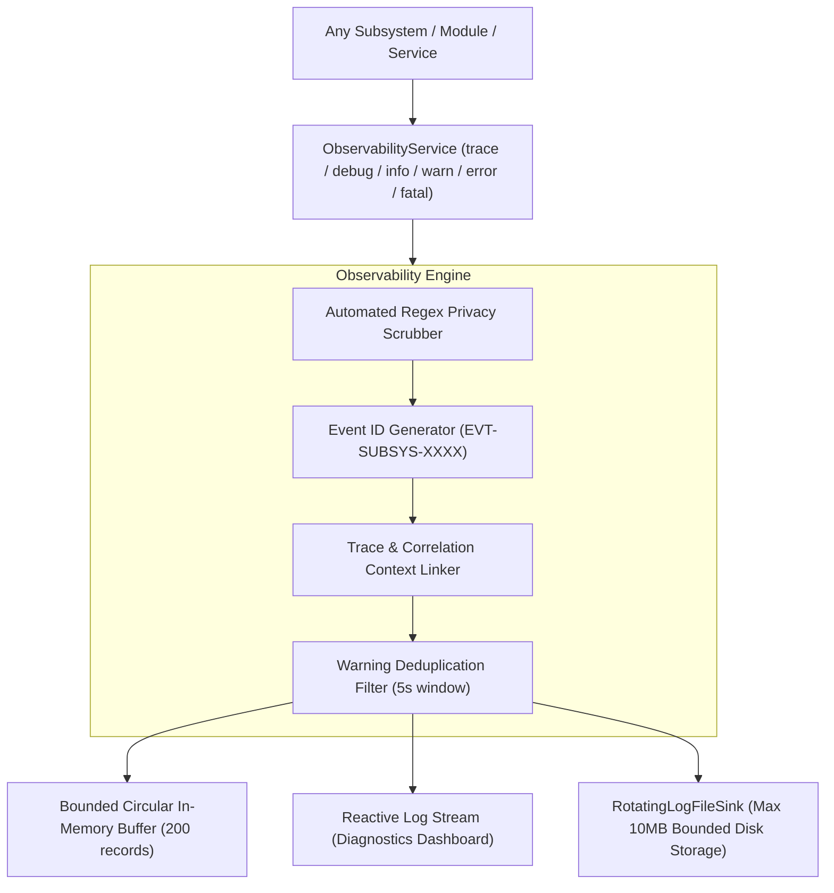
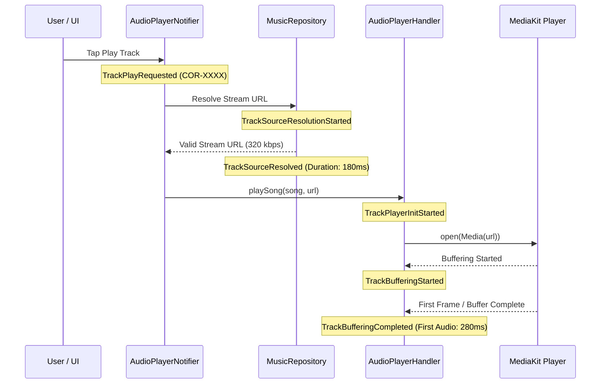

# PROJECT OBSIDIAN — PHASE 6
# OBSERVABILITY AND LOGGING STANDARDS SPECIFICATION
## Enterprise Engineering Standard for Diagnostics, Structured Telemetry & Zero-Telemetry Privacy

---

## 1. Executive Standard

In **Project Obsidian**, software cannot be considered production-ready unless it provides deterministic observability. If an operation fails in production, developers and automated diagnostics must have sufficient telemetry to answer:
1. **What failed** (Exact operation and canonical event name).
2. **Where it failed** (Subsystem, component, and line or method).
3. **Why it failed** (Error code, root cause categorization, and sanitized reason).
4. **What happened immediately before** (Chronological trace of preceding events via shared `correlationId`).
5. **Which component caused it** (Downstream provider, network client, decoder, or UI state).
6. **Whether it recovered** (Fallback attempt, retry execution, or circuit breaker trip).
7. **Platform specificity** (Isolated to Windows, Android, iOS, macOS, Linux, or universal).

---

## 2. Structured Log Schema & Taxonomy

All modules must log exclusively via `ObservabilityService.instance`. Direct calls to `print()` or unformatted `debugPrint()` in production logic are strictly rejected by CI lint rules.



### 2.1 Standardized Severity Levels

| Level | Severity Name | Operational Definition | Production Target |
|---|---|---|---|
| `TRACE` | Detailed Trace | Micro-events, internal loop iterations, fine-grained state changes | Development only; disabled in production builds |
| `DEBUG` | Debug Information | Method entry, resolved network headers, cache check results | Diagnostic mode only |
| `INFO` | Information | Significant lifecycle milestones: playback start, batch queued, mix refreshed | Active in all builds |
| `WARN` | Warning | Degraded operational state: slow query ($>50\text{ms}$), 429 throttle, duplicate artwork | Active in all builds; deduplicated |
| `ERROR` | Error | Operation failed: network timeout, stream 403, decoder reject, database write abort | Active in all builds; persisted to disk |
| `FATAL` | Fatal Failure | Unhandled framework exception, native audio crash, unrecoverable corruption | Flushed to disk immediately; triggers alert |

### 2.2 Standard Canonical Event Format
Every log record emitted to `RotatingLogFileSink` produces valid JSON Lines (JSONL) matching the following schema:

```json
{
  "timestamp": "2026-11-07T12:00:00.000Z",
  "level": "ERROR",
  "appVersion": "3.9.5",
  "buildNumber": "1",
  "platform": "windows",
  "module": "playback",
  "component": "AudioPlayerHandler",
  "eventName": "playback_error",
  "eventId": "EVT-PLBK-7A3F",
  "correlationId": "COR-8B2E10",
  "sessionId": "SES-1049FA",
  "operationDurationMs": 142,
  "errorCode": "ERR-DEC-STREAM",
  "errorMessage": "Native player stream rejected codec format",
  "stackTrace": "at AudioPlayerHandler.playSong (audio_player_handler.dart:355)",
  "metadata": {
    "songId": "song_9921",
    "failureCategory": "decoder",
    "retryCount": 1,
    "didRecover": true
  }
}
```

---

## 3. Playback Diagnostics & Latency SLAs

Playback is the core mission of IT Feels Music. Instrumentation must record every phase of the playback journey:



### 3.1 Playback Performance SLAs

| Metric | Target SLA (p50) | Warning Threshold (p95) | Critical Alert (p99) |
|---|---|---|---|
| **Source Resolution Latency** | $\le 200\text{ ms}$ | $> 600\text{ ms}$ | $> 1500\text{ ms}$ |
| **Time to First Audible Audio**| $\le 350\text{ ms}$ | $> 800\text{ ms}$ | $> 2000\text{ ms}$ |
| **Seek Completion Latency** | $\le 80\text{ ms}$ | $> 250\text{ ms}$ | $> 600\text{ ms}$ |
| **Track Transition Latency** | $\le 100\text{ ms}$ | $> 300\text{ ms}$ | $> 800\text{ ms}$ |

---

## 4. Privacy Redaction & Zero-Leakage Mandate

Under no circumstances may private credentials, personal identity tokens, or filesystem identities leave the device or enter persistent diagnostic archives.

### 4.1 Automated Regex Scrubbing Pipeline
`ObservabilityService.scrubSensitiveData()` executes five deterministic regex filters:
1. **Bearer Tokens**: `Bearer\s+[A-Za-z0-9\-._~+/]+=*` $\longrightarrow$ `Bearer [REDACTED_TOKEN]`.
2. **Email Addresses**: `[a-zA-Z0-9._%+-]+@[a-zA-Z0-9.-]+\.[a-zA-Z]{2,}` $\longrightarrow$ `[REDACTED_EMAIL]`.
3. **Password / Credentials**: `(password|secret|apiKey|token|auth)["\s:=]+...` $\longrightarrow `[REDACTED]`.
4. **User Directories**: `[A-Za-z]:[\\/]Users[\\/][^\\/]+[\\/]` $\longrightarrow$ `C:\Users\[USER]\`.
5. **Signed Stream CDN Tokens**: `(\?|&)(token|auth|sign|signature)=[^&\s]+` $\longrightarrow$ `token=[REDACTED_SIG]`.

---

## 5. Storage Bounding & Log Rotation Standards

To ensure that logging never consumes excessive user storage or degrades disk I/O performance:
- **Maximum File Size per Segment**: $2.0\text{ MB}$.
- **Maximum Segments Retained**: 5 segments general + 5 segments error logs.
- **Total Storage Ceiling**: **$10.0\text{ MB}$ maximum**.
- **Retention Period**: Files older than **7 days** are automatically pruned on application startup.
- **Asynchronous Disk Queue**: Writes dispatch to a background microtask queue batching every $500\text{ms}$ or 10 entries, completely preventing UI frame drops.

---

## 6. Subsystem Error Code Taxonomy

| Subsystem | Prefix | Standard Error Codes | Description |
|---|---|---|---|
| **Playback** | `ERR-PLBK-` | `ERR-PLBK-NET`, `ERR-PLBK-SRC`, `ERR-PLBK-DEC`, `ERR-PLBK-OUT`, `ERR-PLBK-SYNC` | Failure during stream play, decoding, or audio session |
| **Network** | `ERR-NET-` | `ERR-NET-TIMEOUT`, `ERR-NET-429`, `ERR-HTTP-500`, `ERR-NET-DNS` | Remote HTTP/API failure or rate limit throttling |
| **Database** | `ERR-DB-` | `ERR-DB-TRANSACTION`, `ERR-DB-CORRUPT`, `ERR-DB-MIGRATE`, `WARN-DB-SLOW` | Isar or storage read/write errors, slow queries ($>50\text{ms}$) |
| **Content** | `ERR-CONT-` | `WARN-ARTWORK-REPAIR`, `WARN-CONTENT-UNPLAYABLE`, `ERR-CONT-DEDUP` | Living Catalogue and metadata enrichment defects |
| **Framework** | `ERR-FWK-` | `ERR-FWK-RENDER`, `ERR-FWK-UNCAUGHT` | Flutter framework and widget tree exceptions |
| **Platform** | `ERR-PLAT-` | `ERR-PLAT-SMTC`, `ERR-PLAT-SESSION`, `ERR-PLAT-DEVICE` | Native platform channels, OS media control disconnections |

---

## 7. Mandatory Verification for Future Features

Every future feature pull request must fulfill the 5 Observability Gates:
1. Emits structured log events via `ObservabilityService.instance`.
2. Propagates `correlationId` across async calls.
3. Tests verified with zero PII or credentials in logs.
4. Latency-sensitive operations report percentiles to `PerformanceTelemetryTracker`.
5. Features verified in `DiagnosticsDashboardScreen` and exportable in `DiagnosticExportService`.
