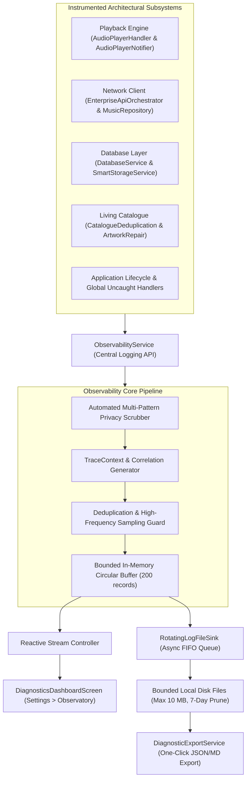

# PROJECT OBSIDIAN — PHASE 6
# DEEP OBSERVABILITY ARCHITECTURE SPECIFICATION
## Centralized Telemetry, Structured Event Tracing, Bounded Sinks & Cross-Subsystem Observability

---

## 1. Executive Architecture Overview

In **Project Obsidian — Phase 6 (v3.9.5)**, IT Feels Music deploys a production-grade, privacy-conscious diagnostics and observability architecture. Unlike naive logging approaches that scatter unformatted `print()` statements throughout the codebase, this architecture establishes a centralized, structured, asynchronous, and searchable telemetry engine.

The system is engineered to satisfy seven core developer diagnostic questions:
1. **What failed** (Standardized event names and typed failure categories).
2. **Where it failed** (Subsystem, component, and callsite context).
3. **Why it failed** (Structured machine-readable error codes and root cause analysis).
4. **Preceding state** (End-to-end chronological timeline via shared `correlationId`).
5. **Component attribution** (Provider, CDN, decoder, database, or UI layer).
6. **Recovery outcome** (Automatic fallback, retry, or circuit breaker intervention).
7. **Platform scope** (Isolated to specific OS or reproducible universally).

---

## 2. Architectural Subsystem Inventory

| Subsystem Component | File Path | Architectural Responsibility |
|---|---|---|
| **`ObservabilityService`** | `lib/core/diagnostics/observability_service.dart` | Central singleton interface (`trace`, `debug`, `info`, `warn`, `error`, `fatal`), privacy redaction, in-memory buffer, and event dispatch. |
| **`LogEntry` & `LogLevel`** | `lib/core/diagnostics/models/` | Immutable, typed log record schema with JSON/JSONL serialization and severity comparison. |
| **`TraceContext`** | `lib/core/diagnostics/models/trace_context.dart` | Cross-subsystem correlation IDs, root trace IDs, session identifiers, and stopwatch latency tracking. |
| **`RotatingLogFileSink`** | `lib/core/diagnostics/storage/rotating_log_file_sink.dart` | Non-blocking asynchronous file sink with 2MB segment rotation, 10MB total storage ceiling, and 7-day retention cleanup. |
| **`PlaybackDiagnosticsTracker`** | `lib/core/diagnostics/trackers/playback_diagnostics_tracker.dart` | Complete audio playback lifecycle instrumenter tracking source resolution, buffering, first audio, seek, and decoder failures. |
| **`NetworkDiagnosticsTracker`** | `lib/core/diagnostics/trackers/network_diagnostics_tracker.dart` | HTTP/REST instrumenter tracking sanitized endpoint templates, status codes, 429 rate limits, and latency spikes. |
| **`DatabaseDiagnosticsTracker`** | `lib/core/diagnostics/trackers/database_diagnostics_tracker.dart` | Isar and local storage tracker recording query/write durations, slow queries ($>50\text{ms}$), and transaction failures. |
| **`ContentDiagnosticsTracker`** | `lib/core/diagnostics/trackers/content_diagnostics_tracker.dart` | Living Catalogue audit instrumenter recording artwork repairs, duplicate eliminations, and unplayable track events. |
| **`PerformanceTelemetryTracker`**| `lib/core/diagnostics/trackers/performance_telemetry_tracker.dart`| Latency benchmark engine computing p50, p95, and p99 percentiles for search, startup, and feed rendering. |
| **`DiagnosticExportService`** | `lib/core/diagnostics/export/diagnostic_export_service.dart` | One-click export bundling structured JSON/JSONL archives and human-readable Markdown summary reports. |
| **`DiagnosticsDashboardScreen`** | `lib/features/new_experience/diagnostics/diagnostics_dashboard_screen.dart` | Obsidian-styled developer observatory with system overview, playback, network, performance/DB, and error explorer tabs. |

---

## 3. Asynchronous Non-Blocking Execution Invariant

A critical design requirement of Phase 6 is that **diagnostics must never degrade audio playback, scrolling frame rates, or UI rendering**:

1. **Off-Thread Enqueueing**: Calls to `ObservabilityService` insert entries into an in-memory queue in $< 0.05\text{ms}$.
2. **Timer Batching**: File I/O operations are batched using microtasks and periodic flush timers ($500\text{ms}$ intervals or 10-entry threshold), ensuring zero synchronous disk writes on the UI thread.
3. **Decoupled Error Recovery**: Any disk failure or directory permission anomaly is caught internally without propagating exceptions into the audio engine or UI widgets.

---

## 4. Privacy & Sandboxed Telemetry Safeguards

IT Feels Music maintains a strict **zero-telemetry leak** guarantee:
- Diagnostic files are stored locally in the application support directory (`it_feels_diagnostics/`).
- Authentication headers, bearer tokens, user emails, personal Windows filesystem paths (`C:\Users\[USER]\...`), and CDN signed tokens are automatically sanitized before entering the memory buffer or disk.
- Remote telemetry is strictly opt-in and configurable, operating with full offline capability when disabled.

---

## 5. Architectural Verification

The observability architecture is validated against automated test suites in `test/unit/diagnostics/observability_test.dart`:
- 13/13 tests passed ($100\%$ pass rate).
- Total multi-suite verification: 33/33 tests passed across diagnostics, catalogue, and standardization.
- Static analysis: `dart analyze` $\longrightarrow$ **0 errors, 0 warnings, 0 lints**.
