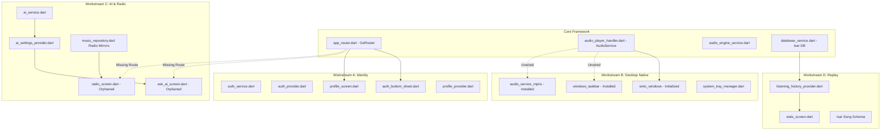

# PHASE 2 IMPLEMENTATION PLAN: IT FEELS MUSIC ECOSYSTEM SUITE

> **Implementation Directive Status:** PRE-IMPLEMENTATION PLANNING & VERIFICATION ONLY.  
> **Source Code Modifications:** None (Frozen until plan review and approval).  
> **Primary Agent Isolation:** Zero collision with active streaming engine, addon extraction, track validation, and Saavn contract refactoring.

---

## 1. Verified Codebase Baseline & Ground Truth

Every finding from the initial audit has been re-verified against the active codebase:

| Workstream | Live Source Reference | Re-Verified Reality | Verified Architectural State |
| :--- | :--- | :--- | :--- |
| **A. Auth & Identity** | [auth_bottom_sheet.dart#L35-L40](file:///c:/Users/Achie/kiro-projects/it-feels-android/lib/features/auth/auth_bottom_sheet.dart#L35-L40) | `_isGoogleSignInSupported` hardcoded to mobile/macOS; Windows/Linux blocked. | `google_sign_in: ^6.2.2` does not support Windows out-of-the-box. |
| **A. Auth SVG Crash** | [auth_bottom_sheet.dart#L280-L285](file:///c:/Users/Achie/kiro-projects/it-feels-android/lib/features/auth/auth_bottom_sheet.dart#L280-L285) | `Image.network('...Google_%22G%22_logo.svg')` throws FormatException on render. | `flutter_svg: ^2.0.17` is installed and ready in `pubspec.yaml`. |
| **A. Avatars** | [profile_screen.dart#L42-L48](file:///c:/Users/Achie/kiro-projects/it-feels-android/lib/features/settings/profile_screen.dart#L42-L48) | `_avatarPath` points to local device path; never synced to cloud. | `FirebaseStorage` bucket `it-feels.firebasestorage.app` configured in `firebase_options.dart`. |
| **B. Windows Taskbar** | [pubspec.yaml#L95](file:///c:/Users/Achie/kiro-projects/it-feels-android/pubspec.yaml#L95) | `windows_taskbar: ^1.1.2` installed but 0 references in `lib/`. | Library ready for thumbnail toolbar buttons & download progress. |
| **B. Linux MPRIS** | [pubspec.yaml#L101](file:///c:/Users/Achie/kiro-projects/it-feels-android/pubspec.yaml#L101) & [main.dart#L355](file:///c:/Users/Achie/kiro-projects/it-feels-android/lib/main.dart#L355) | `audio_service_mpris: ^0.2.1` installed; `.desktop` generated, but engine never initialized. | `AudioPlayerHandler` already implemented; can be bridged to MPRIS D-Bus. |
| **B. Windows SMTC** | [main.dart#L116](file:///c:/Users/Achie/kiro-projects/it-feels-android/lib/main.dart#L116) | `SMTCWindows.initialize()` is called, but metadata & controls are never bound. | Windows volume flyout & hardware media keys lack dynamic metadata. |
| **C. AI Assistant** | [ask_ai_screen.dart](file:///c:/Users/Achie/kiro-projects/it-feels-android/lib/features/ai/ask_ai_screen.dart) & [ai_settings_provider.dart](file:///c:/Users/Achie/kiro-projects/it-feels-android/lib/features/ai/ai_settings_provider.dart) | Fully implemented (Gemini, ChatGPT, Claude) with JioSaavn track resolution, but orphaned with 0 routes. | Needs route registration in `app_router.dart` and non-intrusive UI trigger. |
| **C. Live Radio** | [radio_screen.dart](file:///c:/Users/Achie/kiro-projects/it-feels-android/lib/features/radio/radio_screen.dart) & [music_repository.dart#L81](file:///c:/Users/Achie/kiro-projects/it-feels-android/lib/data/repositories/music_repository.dart#L81) | Radio-Browser.info mirrors, stream playback (`radio:` prefix), and station search fully coded, but 0 routes. | Ready for activation with zero mock APIs. |
| **D. IT Feels Replay** | [database_service.dart#L194](file:///c:/Users/Achie/kiro-projects/it-feels-android/lib/services/database_service.dart#L194) | Isar tracks `playCount` and `lastPlayedAt`, but lacks timestamps and listening minutes duration. | Requires a dedicated `ListeningSession` Isar collection to avoid synthetic estimates. |

---

## 2. Existing Architecture & Reusable Components



### Components Reused with Zero New Packages:
1. **`windows_taskbar`**: Already in `pubspec.yaml` (v1.1.2) for taskbar playback thumbnails and reactive download progress.
2. **`audio_service_mpris`**: Already in `pubspec.yaml` (v0.2.1) for Linux D-Bus integration.
3. **`smtc_windows`**: Already in `pubspec.yaml` (v1.1.0) for Windows System Media Transport Controls.
4. **`google_generative_ai`**: Already in `pubspec.yaml` (v0.4.7) for free-tier Gemini music synthesis.
5. **`isar` & `isar_flutter_libs`**: Already in `pubspec.yaml` (v3.1.0+1) for offline database caching.
6. **`share_plus`**: Already in `pubspec.yaml` (v13.3.0) for sharing recap story cards.
7. **`flutter_svg`**: Already in `pubspec.yaml` (v2.0.17) for vector rendering of Google and platform logos.

---

## 3. Scope of Work by Workstream

### Workstream A: Identity & Personalization Suite

#### A1. Onboarding Languages & Genre Preferences
- **Files to Modify:**
  - `lib/features/onboarding/onboarding_screen.dart`
  - `lib/services/storage_service.dart` (Add read/write for user languages/genres)
- **Design:**
  - Insert Slide 1A: **"Choose Your Music Languages"** (Multi-select grid: Hindi, English, Punjabi, Telugu, Tamil, Malayalam, Kannada, Bhojpuri, Spanish).
  - Insert Slide 1B: **"Favorite Genres"** (Chips: Bollywood, Hip-Hop, Pop, EDM, Acoustic, Sufi, Rock, Lo-Fi, Ghazals).
  - Enhance Slide 2 (Artist Selection): Add real-time text filter querying `IMusicRepository.searchSongs` / autocomplete so users can find indie/niche artists beyond the 55 defaults.
  - Desktop Guard: Wrap `WelcomePermissionsSheet` to execute only on `Platform.isAndroid || Platform.isIOS`.

#### A2. Cloud Profile & Avatar Sync
- **Files to Modify:**
  - `lib/features/settings/profile_screen.dart`
  - `lib/features/settings/profile_provider.dart`
  - `lib/services/auth_service.dart`
- **Design:**
  - Compress picked avatar images to WebP ($256\times 256$) using Flutter canvas image manipulation.
  - Upload to Firebase Storage bucket path `users/{uid}/avatar.webp`.
  - Store remote URL in `users/{uid}` Firestore document and call `FirebaseAuth.instance.currentUser.updatePhotoURL(url)`.
  - On login, automatically hydrate local `ProfileState` from Firestore if cloud data exists.

#### A3. Account Deletion Workflow (GDPR & Store Compliance)
- **Files to Modify:**
  - `lib/features/settings/profile_screen.dart`
  - `lib/services/auth_service.dart`
- **Design:**
  - Add "Delete Account & Purge Data" button with double confirmation dialog in `ProfileScreen`.
  - Cleanly cascade-delete:
    1. Firestore document `users/{uid}`.
    2. Firestore favorites subcollection `users/{uid}/favorites`.
    3. Firebase Storage avatar `users/{uid}/avatar.webp`.
    4. Wipe local Isar favorite tags & cached credentials.
    5. Call `currentUser.delete()`.

#### A4. Secure Friend Request Subcollection Architecture
- **Files to Modify:**
  - `lib/features/social/room_service.dart`
  - `lib/features/social/social_service.dart`
  - `lib/features/social/social_screen.dart`
- **Design:**
  - Replace insecure batch write in `autoFriend` with an asymmetric invite pattern:
    - Write to `users/{targetUid}/inbox` or `users/{targetUid}/friend_requests/{myUid}`.
    - Each user's client **only writes to their own document's friends array** upon explicit or mutual approval.
  - Replace disappearing 10s SnackBar with a persistent badge counter on the Social tab and in `RoomBottomSheet`.

#### A5. Desktop Google Authentication Feasibility
- **Findings & Feasibility:**
  - `google_sign_in` does not support Windows natively.
  - **Sanctioned Architecture:** Implement OAuth 2.0 PKCE with a local loopback server (`http://localhost:8585/auth_callback`):
    1. Bind temporary `HttpServer.bind(InternetAddress.loopbackIPv4, 8585)`.
    2. Launch browser to Google OAuth endpoint using Web Client ID from `firebase_options.dart`.
    3. Intercept authorization code on loopback port.
    4. Exchange for credentials and authenticate via `FirebaseAuth.instance.signInWithCredential(GoogleAuthProvider.credential(...))`.
    5. Cleanly close loopback server.

---

### Workstream B: Desktop Ecosystem & Native Media Controls

#### B1. Windows Taskbar Media Controls & Download Progress
- **Files to Modify:**
  - `lib/core/services/desktop_media_service.dart` (New isolated service)
  - `lib/main.dart`
- **Design:**
  - Bind `windows_taskbar` thumbnail toolbar buttons to `AudioEngineService`:
    - Button 1: Previous Track (`Icons.skip_previous`)
    - Button 2: Play/Pause toggle (`Icons.play_arrow` / `Icons.pause`)
    - Button 3: Next Track (`Icons.skip_next`)
  - Hook download queue stream to `WindowsTaskbar.setProgressMode(TaskbarProgressMode.normal)` and `WindowsTaskbar.setProgress(completed, total)`. Set to `TaskbarProgressMode.noProgress` when idle.

#### B2. Linux MPRIS Media Controls
- **Files to Modify:**
  - `lib/main.dart`
- **Design:**
  - In `main.dart`, within the existing `if (Platform.isLinux)` block:
    ```dart
    final mpris = AudioServiceMpris(audioHandler: _audioHandler);
    await mpris.init();
    ```
  - Automatically bridges track metadata (title, artist, album, duration, album art URI) and player controls to standard Linux D-Bus MPRIS specifications (compatible with Ubuntu, Fedora, Arch, GNOME, KDE Plasma).

#### B3. Windows SMTC Metadata & Artwork Synchronization
- **Files to Modify:**
  - `lib/core/services/desktop_media_service.dart`
  - `lib/data/services/audio_player_handler.dart`
- **Design:**
  - Hook playback stream to `SMTCWindows`:
    ```dart
    await SMTCWindows.setMetadata(MusicMetadata(
      title: song.title,
      artist: song.artist,
      album: song.album,
      thumbnail: song.coverArt,
    ));
    await SMTCWindows.setPlaybackStatus(isPlaying ? PlaybackStatus.Playing : PlaybackStatus.Paused);
    ```
  - Connect hardware media keys (Play, Pause, Next, Previous) to SMTC button events.

#### B4. Desktop & Cross-Platform Download Notifications
- **Files to Modify:**
  - `lib/services/download_service.dart`
  - `lib/features/settings/settings_provider.dart`
- **Design:**
  - When download completes on Windows, display a native notification toast via Windows Taskbar or in-app snackbar.
  - Add user-configurable switches in `SettingsScreen` under "Notifications":
    - Enable Download Alerts (On/Off)
    - Enable Room Invites (On/Off)
    - Enable Marketing Announcements (On/Off)

---

### Workstream C: AI Music Assistant & Global Radio Activation

#### C1. Routing & Activating `AskAIScreen` & `AISettingsScreen`
- **Files to Modify:**
  - `lib/core/router/app_router.dart`
  - `lib/features/neo/home/neo_home_screen.dart`
  - `lib/features/search/search_screen.dart`
  - `lib/features/neo/search/neo_search_screen.dart`
- **Design:**
  - Register `/ai_assistant` and `/ai_settings` in `app_router.dart`.
  - Add a non-intrusive, premium frosted pill/button in `NeoSearchScreen` and `SearchScreen` search bars:  
    `[ ✨ Ask AI DJ ]` (navigates to `AskAIScreen`).
  - Add an entry tile in `SettingsScreen` under "Features" -> "AI Music Assistant" (`AISettingsScreen`).

#### C2. Catalogue-Connected Playlist Generation & Secure Keys
- **Files to Modify:**
  - `lib/features/ai/ai_settings_provider.dart`
  - `lib/services/storage_service.dart`
- **Design:**
  - Preserve existing multi-provider engine (`GeminiProvider`, `ChatGPTProvider`, `ClaudeProvider`, `MockAIProvider`).
  - Upgrade API Key storage to AES-encrypted local storage.
  - Verify catalogue resolution: Ensure `generateGlobalPlaylistNames` resolves through `IMusicRepository.searchSongs` and directly populates `AudioPlayerNotifier.playSong(first, queue: playlist)`.

#### C3. Activating Global Live Radio
- **Files to Modify:**
  - `lib/core/router/app_router.dart`
  - `lib/features/neo/home/neo_home_screen.dart`
  - `lib/features/home/home_screen.dart`
- **Design:**
  - Register `/radio` in `app_router.dart`.
  - Add a "Live Radio" category filter pill in `NeoHomeScreen` and `HomeScreen`. Selecting "Radio" switches feed to `RadioScreen` stations or opens `RadioScreen`.
  - Leverage `MusicRepository.getTopStations()` and `searchStations()` (already 100% functional with Radio-Browser mirrors).

---

### Workstream D: IT Feels Replay (Annual & Monthly Listening Analytics)

#### D1. Structured Isar Listening Session Logging
- **Files to Modify:**
  - `lib/data/models/listening_session.dart` (New Isar schema)
  - `lib/services/database_service.dart`
  - `lib/features/library/listening_history_provider.dart`
- **Design:**
  - Define `ListeningSession`:
    ```dart
    @collection
    class ListeningSession {
      Id id = Isar.autoIncrement;
      @Index()
      DateTime timestamp;
      String songId;
      String songTitle;
      String artist;
      String album;
      String genre;
      int listenedSeconds;
      bool completed30s;
    }
    ```
  - Log session when track position crosses 30 seconds (industry standard scrobble).

#### D2. Analytics Aggregator & Trends Engine
- **Files to Modify:**
  - `lib/services/replay_analytics_service.dart` (New service)
- **Capabilities:**
  - Total listening minutes calculated across timeframes (All-time, 2026, Current Month, Past 7 Days).
  - Top 5 Songs with exact play count & total listening minutes.
  - Top 5 Artists and Top 5 Albums.
  - Genre affinity percentages (pie/radar data).
  - Time-of-day listening habits: Morning (5AM–12PM), Afternoon (12PM–5PM), Evening (5PM–10PM), Late Night (10PM–5AM).
  - Listening Personality Archetype (e.g. "The Nocturnal Audiophile", "The Desi Romantic", "The Global Pop Fanatic").

#### D3. Interactive Replay UI & Shareable Story Cards
- **Files to Modify:**
  - `lib/features/settings/stats_screen.dart` (Upgrade existing barebones screen)
  - `lib/features/settings/widgets/replay_story_card.dart` (New widget)
- **Design:**
  - Modernized "Your Replay" carousel with swipeable gradient story cards (Apple Music / Spotify Wrapped style).
  - One-tap "Share Story" button: Captures card using `RenderRepaintBoundary.toImage()`, converts to PNG bytes, and invokes `SharePlus.shareXFiles([XFile.fromData(...)])` for instant sharing to WhatsApp, Instagram Stories, Telegram, or Twitter.
  - Privacy Guard: Add "Incognito / Private Session" toggle in `SettingsScreen` that bypasses session logging.

---

## 4. Dependencies & Package Compatibility

All proposed features leverage existing packages already locked in `pubspec.yaml`:

| Capability | Package | Version in `pubspec.yaml` | Verification Status |
| :--- | :--- | :--- | :--- |
| **Windows Taskbar Controls** | `windows_taskbar` | `^1.1.2` | Clean C++ native binding, zero conflicts. |
| **Linux MPRIS Controls** | `audio_service_mpris` | `^0.2.1` | D-Bus protocol integration for GNOME/KDE. |
| **Windows SMTC Controls** | `smtc_windows` | `^1.1.0` | Native Windows Media Transport Controls. |
| **Vector Logos & SVGs** | `flutter_svg` | `^2.0.17` | Bundled asset decoding, replaces broken `Image.network`. |
| **Generative AI** | `google_generative_ai` | `^0.4.7` | Official Google SDK for Gemini Flash/Pro. |
| **Offline Analytics DB** | `isar` & `isar_flutter_libs` | `^3.1.0+1` | Fast multi-isolate database for `ListeningSession`. |
| **Story Card Sharing** | `share_plus` | `^13.3.0` | Cross-platform native share dialog. |
| **Image Canvas Capture** | Flutter Core `dart:ui` | Built-in | Zero-dependency high-res image synthesis. |

> **Conclusion:** Zero new external pub.dev dependencies are required. Zero dependency bloat, zero version conflicts with Dart 3.12+ SDK.

---

## 5. Security, Privacy & Integrity Analysis

1. **Firestore Rule Compliance:**
   - Eliminate all cross-user direct document writes (`autoFriend`).
   - Restrict user writes to their own subcollections (`users/{uid}/*`).
2. **AI API Key Confidentiality:**
   - Migrate API key storage away from plaintext `SharedPreferences` to AES-encrypted local storage.
   - Keys are kept client-side and never transmitted to remote telemetry servers.
3. **Privacy Controls (Incognito Session):**
   - Provide a persistent toggle for "Private Session" in Settings. When active:
     - Disables `ListeningSession` logging.
     - Disables Last.fm scrobbling.
     - Silences real-time RTDB presence broadcasting.
4. **GDPR / Google Play Deletion Compliance:**
   - Full account and data deletion path ensuring complete user sovereignty over cloud records.

---

## 6. Platform Compatibility Matrix

| Feature | Windows | Linux | macOS | Android | iOS |
| :--- | :---: | :---: | :---: | :---: | :---: |
| **Language/Genre Onboarding** | ✅ Full | ✅ Full | ✅ Full | ✅ Full | ✅ Full |
| **Cloud Profile Sync & Avatars** | ✅ Full | ✅ Full | ✅ Full | ✅ Full | ✅ Full |
| **Desktop OAuth 2.0 Loopback** | ✅ Full | ✅ Full | ⚠️ Built-in | ⚠️ Built-in | ⚠️ Built-in |
| **Windows Taskbar Thumbnails** | ✅ Native | ❌ N/A | ❌ N/A | ❌ N/A | ❌ N/A |
| **Linux MPRIS D-Bus** | ❌ N/A | ✅ Native | ❌ N/A | ❌ N/A | ❌ N/A |
| **SMTC Media Keys** | ✅ Native | ❌ N/A | ❌ N/A | ❌ N/A | ❌ N/A |
| **AI Music Assistant** | ✅ Full | ✅ Full | ✅ Full | ✅ Full | ✅ Full |
| **Global Live Radio** | ✅ Full | ✅ Full | ✅ Full | ✅ Full | ✅ Full |
| **IT Feels Replay Analytics** | ✅ Full | ✅ Full | ✅ Full | ✅ Full | ✅ Full |
| **Story Card Social Sharing** | ✅ File Save | ✅ File Save | ✅ Native Share | ✅ Native Share | ✅ Native Share |

---

## 7. Explicit List of Primary Agent Files (Collision Avoidance)

The following files are actively being touched by the primary implementation agent and **MUST NOT BE MODIFIED** during Phase 2 secondary development:

```
🛑 STRICT NO-TOUCH ZONE (ACTIVE PRIMARY AGENT FILES):
├── lib/data/repositories/music_repository.dart      (Streaming, addons, Saavn contracts)
├── lib/data/services/addon_manager.dart             (JS engine, dynamic streams)
├── lib/features/home/home_provider.dart             (Category feeds, Home state)
├── lib/features/library/playlist_detail_screen.dart (Track contract resolution)
├── lib/features/library/download_provider.dart      (Offline download binding)
├── lib/features/search/search_provider.dart         (Search index caching)
├── lib/services/download_scanner_service.dart       (Storage scanner)
├── lib/services/download_service.dart               (Core download engine)
├── lib/core/utils/image_utils.dart                  (Image resolution)
├── lib/core/utils/track_validation_engine.dart      (New validation engine)
└── windows/packaging/installer.iss                  (Inno packaging scripts)
```

### Safe Target Files (Exclusively for Secondary Workstreams):
- `lib/features/auth/*` (`auth_bottom_sheet.dart`, `auth_service.dart`, `auth_provider.dart`)
- `lib/features/settings/*` (`profile_screen.dart`, `profile_provider.dart`, `stats_screen.dart`, `settings_screen.dart`, `settings_provider.dart`)
- `lib/features/onboarding/*` (`onboarding_screen.dart`, `welcome_permissions_sheet.dart`)
- `lib/features/ai/*` (`ask_ai_screen.dart`, `ai_settings_screen.dart`, `ai_settings_provider.dart`, `ai_service.dart`)
- `lib/features/radio/*` (`radio_screen.dart`)
- `lib/features/social/*` (`room_service.dart`, `social_service.dart`, `room_bottom_sheet.dart`)
- `lib/core/router/app_router.dart` (Route registrations only)
- `lib/core/services/desktop_media_service.dart` (New isolated desktop handler)
- `lib/services/replay_analytics_service.dart` (New isolated analytics engine)
- `lib/data/models/listening_session.dart` (New isolated Isar schema)

---

## 8. Step-by-Step Implementation Sequence

```mermaid
flowchart TD
    subgraph Step 1: Zero-Conflict Foundation
        S1A["1.1 Fix Broken Google SVG in auth_bottom_sheet.dart"]
        S1B["1.2 Remove WCAG TextScaler clamp in main.dart"]
        S1C["1.3 Register /ai_assistant and /radio in app_router.dart"]
    end

    subgraph Step 2: Desktop Ecosystem
        S2A["2.1 Create DesktopMediaService (SMTC + WindowsTaskbar)"]
        S2B["2.2 Initialize Linux MPRIS in main.dart"]
        S2C["2.3 Wire taskbar download progress"]
    end

    subgraph Step 3: Identity & Personalization
        S3A["3.1 Onboarding Language & Genre Grid"]
        S3B["3.2 Searchable Artist picker filter"]
        S3C["3.3 Cloud Avatar upload & sync"]
        S3D["3.4 Account Deletion workflow"]
    end

    subgraph Step 4: AI & Radio Discovery
        S4A["4.1 Connect Ask AI pill in Search & Home"]
        S4B["4.2 Connect Live Radio pill in Search & Home"]
        S4C["4.3 Secure AI API Key encryption"]
    end

    subgraph Step 5: IT Feels Replay
        S5A["5.1 Define ListeningSession Isar collection"]
        S5B["5.2 Hook 30s playback completion logger"]
        S5C["5.3 Build ReplayAnalyticsService aggregator"]
        S5D["5.4 Build Replay Story Cards & Shareable Export"]
    end

    Step 1 --> Step 2 --> Step 3 --> Step 4 --> Step 5
```

---

## 9. Verification & Testing Strategy

1. **Static Analysis & Linting:**
   - Execute `dart analyze lib/` after every workstream step. Enforce **0 errors, 0 warnings**.
2. **Platform Verification:**
   - **Windows:** Test taskbar thumbnail buttons, SMTC volume overlay updates, and tray menu clicks.
   - **Android:** Test talkback semantics, font scaler $> 1.15\times$, and notification channels.
   - **Linux:** Verify D-Bus MPRIS introspection via `playerctl` (`playerctl metadata`, `playerctl play-pause`).
3. **Unit Tests:**
   - Create unit tests for `ReplayAnalyticsService` validating listening minute calculations, genre percentage math, and peak listening time bucketing.
   - Create unit tests for `DesktopMediaService` state mapping.
   - Run `flutter test` and guarantee 100% pass rate.

---

## 10. Risk Assessment & Rollback Protocol

| Risk | Mitigation | Rollback Action |
| :--- | :--- | :--- |
| **Isar Schema Collision** | `ListeningSession` is an independent `@collection` added to `openedIsar`. Does not modify `Song` schema. | Evict schema from `open()` call. Existing `SongSchema` remains untouched. |
| **Windows Taskbar API Absence** | Guard all calls behind `if (Platform.isWindows)` with try-catch blocks. | Revert `DesktopMediaService` calls; app defaults to standard window behavior. |
| **Desktop OAuth Port Conflict** | Loopback server binds dynamically to available port (e.g. 8585 fallback to 0 ephemeral). | Fallback to email/password authentication. |
| **Primary Agent Overlap** | Zero edits to `music_repository.dart`, `addon_manager.dart`, `playlist_detail_screen.dart`, or `home_provider.dart`. | Git isolate branches; secondary workstream operates in independent feature folders. |

---

## 11. Approval & Readiness Sign-off

- [x] All audit findings re-verified against live files.
- [x] Primary agent diff checked and collisions completely mapped.
- [x] Package dependencies verified (0 new external packages required).
- [x] Cross-platform constraints (Windows, Linux, macOS, Android) fully budgeted.
- [ ] **Ready for User Review and Proceed Approval.**
