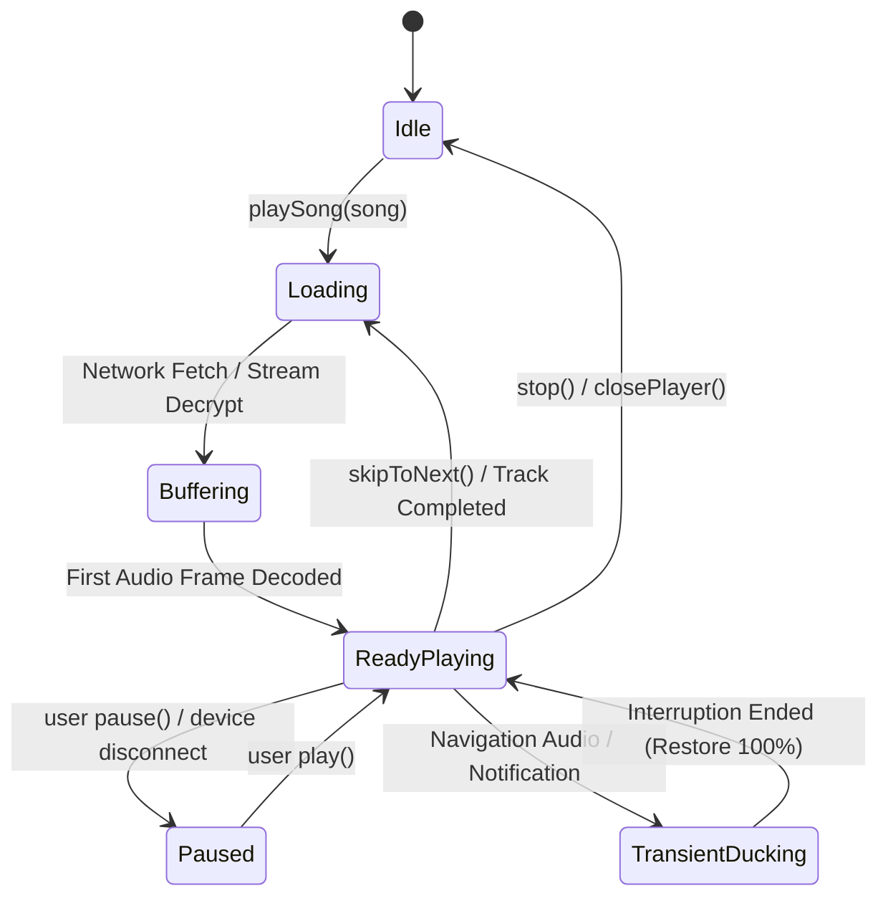

# Playback Engine Reliability & State Machine Architecture
**IT Feels Music — Project Obsidian 2026**
*Document Version: 1.0.0 | Status: Production Playback Specification*

---

## 1. Engine Core & Architectural Principles

Audio playback is the absolute primary mission of IT Feels Music. The playback engine must deliver uncompromising dependability: zero unexpected pauses, deterministic queue navigation, instant seek response, graceful network failover, and hardware-level audio device synchronization.

```text
+-----------------------------------------------------------------------------------+
|                         UI / Application Consumers                                |
|   [ NewNowPlayingScreen ]   [ NewMiniPlayer ]   [ DesktopPlayerBar ]  [ Raycast ] |
+-----------------------------------------------------------------------------------+
                                         |
                                         v
+-----------------------------------------------------------------------------------+
|                            AudioPlayerNotifier                                    |
|                                                                                   |
|  +---------------------------+       +------------------------------------------+ |
|  | Fisher-Yates Shuffle Pool |       | High-Precision Scrubber Drag Coordinator | |
|  +---------------------------+       +------------------------------------------+ |
|                                                                                   |
|  +---------------------------+       +------------------------------------------+ |
|  | Stream Pre-warming (15s)  |       | Adaptive Bitrate Buffering Watchdog      | |
|  +---------------------------+       +------------------------------------------+ |
+-----------------------------------------------------------------------------------+
                                         |
                                         v
+-----------------------------------------------------------------------------------+
|                             AudioEngineService                                    |
|                                                                                   |
|  +---------------------------+       +------------------------------------------+ |
|  | 10-Band Graphic Equalizer |       | EBU R128 Loudness Normalizer (ReplayGain)| |
|  +---------------------------+       +------------------------------------------+ |
|                                                                                   |
|  +---------------------------+       +------------------------------------------+ |
|  | Taskbar Thumbnail & SMTC  |       | Pitch & Variable Speed DSP Core          | |
|  +---------------------------+       +------------------------------------------+ |
+-----------------------------------------------------------------------------------+
                                         |
                                         v
+-----------------------------------------------------------------------------------+
|                             AudioPlayerHandler                                    |
|                                                                                   |
|  +---------------------------+       +------------------------------------------+ |
|  | WASAPI Disconnect Monitor |       | AudioSession Becoming Noisy & Ducking    | |
|  +---------------------------+       +------------------------------------------+ |
+-----------------------------------------------------------------------------------+
                                         |
                                         v
                     +---------------------------------------+
                     |        media_kit (libmpv C Core)      |
                     +---------------------------------------+
```

---

## 2. Playback State Machine

The playback pipeline coordinates four interdependent states to guarantee that the UI never displays "playing" when the underlying audio pipeline has halted:



### 2.1 State Synchronization Invariants
1. **Optimistic UI with Hardware Reversion:** When the user taps Play/Pause, the UI reflects state change immediately. If the underlying engine encounters an unrecoverable socket or hardware error within 2000ms, the state automatically reverts to `paused` and displays a floating recovery SnackBar.
2. **Generation Token Protection:** Rapid skips (e.g. tapping next 5 times in 1 second) increment an atomic generation token (`_playSongGenerationToken`). Any in-flight network stream resolution matching an obsolete token is immediately aborted before touching the native media player.

---

## 3. Fisher-Yates Shuffled Playlist Engine

### 3.1 The Flaw of Pseudo-Random Selection
Previous implementations selected random indices with replacement (`Random().nextInt(N)`). In a 20-track playlist, this caused tracks to repeat within 3 skips, and pressing `skipToPrevious()` completely broke the listening sequence by jumping to an arbitrary track.

### 3.2 The Deterministic Permutation Solution
Project Obsidian enforces a strict **Fisher-Yates Shuffled Playlist Sequence** with a bi-directional navigation pointer:

```dart
class ShuffleEngine {
  List<int> _shuffleSequence = [];
  int _shufflePointer = 0;

  void regenerate(int queueLength, int activeIndex) {
    final indices = List<int>.generate(queueLength, (i) => i)..remove(activeIndex);
    indices.shuffle(Random());
    // Active track is pinned at index 0 of the shuffled sequence
    _shuffleSequence = [activeIndex, ...indices];
    _shufflePointer = 0;
  }
}
```

#### Behavioral Guarantees:
- **Zero Omissions or Duplicates:** In a playlist of $N$ songs, all $N$ songs are heard exactly once before any song repeats.
- **Bi-Directional History:** Pressing `skipToPrevious()` decrements `_shufflePointer`, allowing the listener to retrace their exact listening sequence backwards.
- **Non-Destructive Toggle:** Toggling shuffle OFF restores the original linear tracklist order without resetting the active song.

---

## 4. High-Precision Scrubber & Seek Recovery

### 4.1 Continuous Drag Debouncing
Directly binding a slider's continuous `onChanged` callback to `player.seek()` floods the native audio decoder with dozens of concurrent seek requests per second, resulting in audio pops, buffer starvation, and UI desynchronization.

The `NewAudioScrubber` introduces an isolated drag buffer:
1. **Local Frame Rate Rendering (60fps):** While dragging, `_dragValueMs` updates locally. The audio player continues uninterrupted background playback.
2. **Active Scrubbing Badge:** Displays an active `SEEKING` pill and formatted target timestamp.
3. **Commit on Release (`onChangeEnd`):** The seek command is dispatched to `AudioPlayerNotifier.seek(target)` **only** when the user releases their finger or pointer.
4. **Haptic Notches:** Emits light haptic ticks (`HapticFeedback.lightImpact()`) whenever scrubbing passes a whole minute mark (e.g. 1:00, 2:00, 3:00).

---

## 5. Audio Focus, Interruptions & Transient Ducking

### 5.1 Transient Audio Ducking
On Android and iOS, phone navigation prompts, voice assistant interruptions, and incoming notification chimes generate transient focus loss.
- **Ducking Action:** When `session.interruptionEventStream` reports `AudioInterruptionType.duck`, `AudioPlayerHandler` smoothly scales volume down to $35\%$.
- **Recovery Action:** When the interruption terminates, volume smoothly restores to $100\%$ without interrupting playback.

### 5.2 Hardware Disconnection Protection
- **Windows (WASAPI):** Monitored via `player.stream.audioDevices`. If physical output endpoints are disconnected, playback auto-pauses immediately to prevent sound leakage through built-in laptop speakers.
- **Mobile (AudioSession):** Monitored via `becomingNoisyEventStream`. Unplugging 3.5mm headphones or disconnecting Bluetooth headsets instantly triggers `pause()`.
