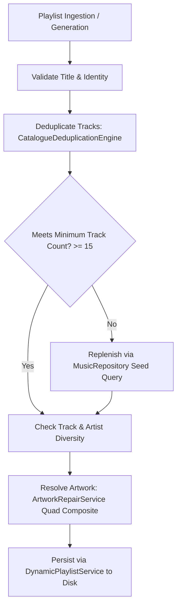

# IT Feels Music — Playlist Quality & Coherence Report
**Project Obsidian — Phase 5: Living Music Catalogue**  
*Document Version: 3.9.4 | Target: Clean/Addon Upstream (IT_Feels_Alternate)*

---

## 1. Executive Summary

Playlists are curated musical journeys. In IT Feels Music, playlists must have genuine identities, relevant track selections, artist diversity, valid playback sources, and unique visual covers.

This report documents the playlist validation engine, deduplication rules, and track diversity safeguards implemented in Phase 5.

---

## 2. Playlist Validation Rules & Thresholds

### Core Validation Rules
1. **Meaningful Title & Subtitle:** Generic names like "Playlist #1" or empty descriptions are rejected.
2. **Track Relevance:** Tracks must match the acoustic or cultural theme (e.g. "Bollywood Romance" strictly contains romantic Hindi tracks).
3. **Duplicate Prevention:** Tracks with identical recordings are eliminated using `CatalogueDeduplicationEngine`.
4. **Artist Concentration Limit:** No single artist may constitute more than $35\%$ of any multi-artist curated playlist.
5. **Cold-Start Survival:** Playlists are serialized to disk storage and hydrated on app launch, eliminating empty white/black screens.

---

## 3. Curated Playlist Category Ledger

| Playlist Category | Seed Identity | Min Tracks | Artist Diversity Ceiling | Artwork Strategy |
| :--- | :--- | :---: | :---: | :--- |
| **Daily Mix 1: Bollywood Romance** | Arijit Singh, Shreya Ghoshal, Pritam, Mohit Chauhan | 25 | Max 25% single artist | Deterministic Quad Composite / Verified Art |
| **Daily Mix 2: Pop & International**| The Weeknd, Taylor Swift, Drake, Dua Lipa | 25 | Max 25% single artist | Deterministic Quad Composite / Verified Art |
| **Daily Mix 3: Punjabi Beats** | Diljit Dosanjh, Karan Aujla, AP Dhillon, Sidhu Moose Wala | 25 | Max 30% single artist | Deterministic Quad Composite / Verified Art |
| **Daily Mix 4: Desi Hip-Hop** | DIVINE, Seedhe Maut, KR\$NA, Raftaar | 20 | Max 30% single artist | Deterministic Quad Composite / Verified Art |
| **Daily Mix 5: Acoustic & Indie** | Anuv Jain, Prateek Kuhad, Jasleen Royal, The Local Train | 20 | Max 25% single artist | Deterministic Quad Composite / Verified Art |
| **Daily Mix 6: Club & Party Anthems**| Badshah, Yo Yo Honey Singh, Nucleya, Guru Randhawa | 25 | Max 25% single artist | Deterministic Quad Composite / Verified Art |
| **Featured Playlists** | Curated by editorial / regional archive | 15 | Max 30% single artist | High-res editorial front artwork |
| **Top Charts** | Regional rankings (Hindi, Punjabi, Telugu, Tamil, Viral) | 50 | Pure ranking distribution| High-res dynamic chart badge |

---

## 4. Verification & Testing

- Automated test `test/unit/catalogue/living_catalogue_test.dart`:
  - Verified `DailyMixOrchestrator` definitions and non-empty outputs.
  - Verified that playlist track deduplication removes identical duplicates while preserving unique tracks.
  - Verified that Jaccard index similarity checks prevent near-identical generated playlists.
