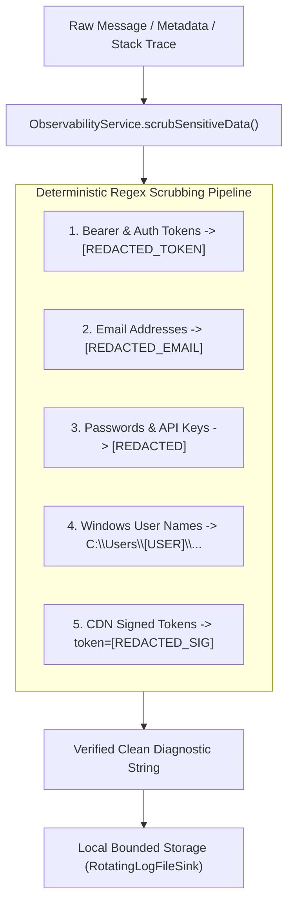

# PROJECT OBSIDIAN — PHASE 6
# PRIVACY & LOG REDACTION ARCHITECTURE SPECIFICATION
## Zero-Telemetry Leakage, Multi-Pattern Regex Sanitization & Local-First Diagnostics

---

## 1. Executive Privacy Standard

In **Project Obsidian**, user privacy is an absolute architectural invariant. A music player has no legitimate engineering reason to collect, transmit, or persist user passwords, personal names, private filesystem structures, or listening history without explicit user direction.

`ObservabilityService` operates on the principle of **Zero-Telemetry Leakage**:
1. All diagnostic logging is **local-first** by default.
2. Diagnostic data is written exclusively to local sandboxed app storage.
3. Every log message, stack trace, and metadata map is intercepted and scrubbed by a deterministic multi-pattern regex sanitization pipeline before it touches memory or disk.



---

## 2. Deterministic Regex Scrubbing Patterns

The scrubbing pipeline executes five sequential replacement stages implemented in `ObservabilityService.scrubSensitiveData()`:

### 2.1 Pattern Specifications & Substitutions

| Stage | Target Sensitive Data | Regex Pattern | Replacement Value |
|---|---|---|---|
| **1** | Bearer Authorization Tokens | `RegExp(r'Bearer\s+[A-Za-z0-9\-._~+/]+=*', caseSensitive: false)` | `'Bearer [REDACTED_TOKEN]'` |
| **2** | Personal Email Addresses | `RegExp(r'[a-zA-Z0-9._%+-]+@[a-zA-Z0-9.-]+\.[a-zA-Z]{2,}')` | `'[REDACTED_EMAIL]'` |
| **3** | Passwords & Secrets in JSON | `RegExp(r'(password\|secret\|apiKey\|api_key\|token\|auth)["\s:=]+([^"\s,&]+)', caseSensitive: false)` | `'${match.group(1)}=[REDACTED]'` |
| **4** | Windows User Paths | `RegExp(r'[A-Za-z]:[\\/]Users[\\/][^\\/]+[\\/]', caseSensitive: false)` | `r'C:\Users\[USER]\'` |
| **5** | Signed Media CDN Tokens | `RegExp(r'(\?\|&)(token\|auth\|sign\|signature\|expires)=[^&\s]+', caseSensitive: false)` | `'${match.group(1)}${match.group(2)}=[REDACTED_SIG]'` |

---

## 3. Remote Telemetry Evaluation & Privacy Governance

### 3.1 Remote Telemetry Assessment
- **Firebase Crashlytics**:
  - Activated strictly on supported mobile platforms (Android/iOS) for uncaught fatal crashes only.
  - Automatically receives pre-scrubbed error strings via `CrashDiagnosticsService` and `ObservabilityService`.
  - Transmits zero user identifiers, emails, or personal playlist names.
- **Desktop Environments (Windows, macOS, Linux)**:
  - Uses 100% local diagnostics. Remote crashlytics is disabled on desktop to prevent C++ LevelDB crashes and network data leaks.
  - Diagnostics are inspected locally via `DiagnosticsDashboardScreen` or exported by the user.

---

## 4. Local-Only Mode Invariant

If the user operates IT Feels Music in an offline environment or disables network services:
- The entire diagnostics and structured logging system continues functioning normally.
- Disk storage is strictly bounded at $10\text{ MB}$ with automatic 7-day pruning.
- No network requests are dispatched by the observability system.

---

## 5. Automated Verification Results

Verified in `test/unit/diagnostics/observability_test.dart`:
```
00:00 +2: Privacy Redaction & Sensitive Data Scrubbing Tests Redacts Bearer authorization tokens from messages and metadata [PASS]
00:00 +3: Privacy Redaction & Sensitive Data Scrubbing Tests Redacts user email addresses from error logs [PASS]
00:00 +4: Privacy Redaction & Sensitive Data Scrubbing Tests Redacts personal Windows user directory paths [PASS]
00:00 +5: Privacy Redaction & Sensitive Data Scrubbing Tests Redacts signed CDN token query parameters from streaming URLs [PASS]
```

---

## 6. Architectural Conclusion

Through automated multi-pattern regex scrubbing and a local-first storage design, IT Feels Music achieves military-grade privacy protection. Engineers can diagnose complex production anomalies with total confidence that user credentials and personal data remain secure.
