# IT FEELS MUSIC — UI REDEVELOPMENT BLUEPRINT (PHASE 0 AUDIT)
**Version:** 4.0.0-nextgen  
**Architecture:** Dual Presentation Layer (Classic UI vs New Experience)  
**Date:** November 2026  
**Status:** Approved & Under Active Implementation  

---

## 1. Executive Summary & Vision

IT Feels Music is evolving into a dual-experience architecture:
1. **Classic UI**: The rock-solid, production-tested existing interface. Preserved 100% untouched for users who prefer the familiar layout. Default for existing installations.
2. **New Experience (2026 Generation)**: A state-of-the-art, luxury music streaming experience inspired by modern desktop and mobile media standards. Features true adaptive multi-column desktop layouts, fluid mobile navigation, dynamic cover art mesh canvases, deep catalogue discovery, synchronized lyrics, immersive artist pages, and verified Spotify playlist importing.

Crucially:
- **Zero Parallel Backends**: Both interfaces share the exact same audio engine (`just_audio`), repositories (`MusicRepository`), download manager (`DownloadService`), authentication (`AuthService`), database (`DatabaseService` / Isar), and Riverpod state providers.
- **Zero Playback Disruption**: Switching between Classic UI and New Experience from Settings occurs live in $<50\text{ms}$ without interrupting active audio playback, dropping queue state, or resetting session variables.

---

## 2. Existing Application Audit & Route Map

### 2.1 Navigation & Router Baseline (`lib/core/router/app_router.dart`)
- **Initial Location**: `/` $\rightarrow$ redirects to `/onboarding` if first launch, otherwise `/home`.
- **Primary Shell**: `StatefulShellRoute.indexedStack` with 6 branches:
  1. Index 0: `/home` $\rightarrow$ `HomeScreen`
  2. Index 1: `/search` $\rightarrow$ `SearchScreen`
  3. Index 2: `/library` $\rightarrow$ `LibraryScreen`
  4. Index 3: `/videos` $\rightarrow$ `VideoTabScreen`
  5. Index 4: `/social` $\rightarrow$ `SocialScreen`
  6. Index 5: `/settings` $\rightarrow$ `SettingsScreen`
- **Fullscreen & Modal Routes**:
  - `/now_playing` $\rightarrow$ `NowPlayingScreen` (Slide transition)
  - `/fullscreen_music` $\rightarrow$ `FullscreenMusicScreen` (Fade transition)
  - `/audio_settings` $\rightarrow$ `AudioSettingsScreen`
  - `/onboarding` $\rightarrow$ `OnboardingScreen`
  - `/driving_mode` $\rightarrow$ `DrivingModeScreen`
  - `/room/:roomId` $\rightarrow$ `RoomDeepLinkScreen`
  - `/song/:songId` $\rightarrow$ `SongDeepLinkScreen`
  - `/download/:downloadId` $\rightarrow$ `DownloadDeepLinkScreen`

### 2.2 Existing Screen Inventory
| Screen Name | File Path | Responsibilities | Preservation Status |
|---|---|---|---|
| `HomeScreen` | `lib/features/home/home_screen.dart` | Classic feed, category tabs, smart recommendations | Preserved Untouched |
| `SearchScreen` | `lib/features/search/search_screen.dart` | Classic search bar, live results, Raycast shortcut | Preserved Untouched |
| `LibraryScreen` | `lib/features/library/library_screen.dart` | Tabs for Playlists, Liked Songs, Downloads, History | Preserved Untouched |
| `NowPlayingScreen` | `lib/features/player/now_playing_screen.dart` | Classic vinyl album art, seek bar, queue, lyrics | Preserved Untouched |
| `SettingsScreen` | `lib/features/settings/settings_screen.dart` | Collapsible settings sections, appearance, audio | Enhanced with App Experience Selector |
| `PlaylistDetailScreen` | `lib/features/library/playlist_detail_screen.dart` | Playlist tracks, responsive wrap buttons, play all | Preserved Untouched |
| `ArtistDetailScreen` | `lib/features/library/artist_detail_screen.dart` | Artist hits, albums, bio | Preserved Untouched |
| `SocialScreen` | `lib/features/social/social_screen.dart` | Listen Together rooms, live chat, chat unread counters | Preserved Untouched |
| `VideoTabScreen` | `lib/features/player/video_tab_screen.dart` | Music videos feed & fullscreen video player | Preserved Untouched |

### 2.3 Shared Service & Provider Dependency Map

```mermaid
graph TD
    subgraph Shared Business Logic Layer
        AP[audioPlayerProvider / AudioPlayerNotifier]
        MR[MusicRepository / AddonManager]
        DP[downloadProvider / DownloadService]
        LH[listeningHistoryProvider]
        CP[customPlaylistProvider]
        AU[authProvider / AuthService]
        SS[settingsProvider / StorageService]
        TVE[TrackValidationEngine]
    end

    subgraph UI Experience Router
        AER[AppExperience / appExperienceProvider]
    end

    subgraph Presentation Layer: Classic UI
        CS[MainNavigationWrapper]
        CH[HomeScreen]
        CSearch[SearchScreen]
        CL[LibraryScreen]
        CNP[NowPlayingScreen]
    end

    subgraph Presentation Layer: New Experience 2026
        NES[NewExperienceShell]
        NEH[NewHomeScreen]
        NESearch[NewSearchScreen]
        NEL[NewLibraryScreen]
        NENP[NewNowPlayingScreen]
        NEP[NewPlaylistDetailScreen]
        NEA[NewArtistDetailScreen]
        NEImp[NewSpotifyImportScreen]
        NEDl[NewDownloadsScreen]
        NEAI[NewAIDiscoveryScreen]
    end

    AER -->|classic| CS
    AER -->|newExperience| NES

    CS --> AP & MR & DP & LH & CP & AU & SS
    NES --> AP & MR & DP & LH & CP & AU & SS & TVE
```


---

## 3. Dual UI Foundation Design (Phase 1)

### 3.1 Experience Enum & Persistence Contract
```dart
enum AppExperience {
  classic,
  newExperience,
}
```
- Stored key in SharedPreferences: `'app_experience_mode'` (`'classic'` vs `'newExperience'`).
- Backward compatibility: Existing installations default to `AppExperience.classic`.
- Reactive Provider: `appExperienceProvider` (`StateNotifierProvider<AppExperienceNotifier, AppExperience>`).

### 3.2 Live Switching Mechanism
Switching experience does NOT call `runApp` or kill the process:
1. `appExperienceProvider.notifier.setExperience(newMode)` updates state and persists to disk.
2. The root navigation router detects the reactive experience state change.
3. Because Riverpod providers (`audioPlayerProvider`, etc.) live at the root `ProviderContainer`, audio streams, playlists, and socket connections remain intact.

---

## 4. New Experience Design Specification (Phase 2 & 3)

### 4.1 Responsive Breakpoints
- **Compact Mobile (< 600 dp)**:
  - Ergonomic bottom navigation dock (`NeoMobileDock` / `NewMobileDock`).
  - Floating mini-player with horizontal gesture scrubbing.
  - One-tap expand to immersive `NewNowPlayingScreen`.
- **Medium / Tablet & Mobile Landscape (600 dp - 1024 dp)**:
  - Adaptive 2-column or 3-column discovery grids.
  - Slim navigation rail with icon tooltips.
  - Compact docked bottom player bar.
- **Expanded Desktop (> 1024 dp)**:
  - Collapsible navigation sidebar (pinned width 240 dp, collapsed width 72 dp).
  - Main scrollable discovery viewport with dynamic ambient art lighting.
  - Optional right-hand contextual drawer (Lyrics & Up Next Queue).
  - Full-width persistent bottom playback bar with volume slider, waveform progress, track metadata, and quick controls.

### 4.2 Luxury Visual Identity
- **Palette**: Deep Obsidian (`#0A0A0C`), Midnight Surface (`#141418`), Elevated Glass (`#1F1F26`), Radiant Neon Violet (`#7C3AED`), Electric Cyan (`#06B6D4`), Emerald Mint (`#10B981`).
- **Typography**: Google Fonts Inter and Outfit with clear visual hierarchy (Headline 32sp, Title 20sp, Body 14sp, Caption 12sp).
- **Surface Elevation**: Frosted glass (`BackdropFilter` with $\sigma = 18-24$), subtle $1\text{px}$ specular border highlight (`Colors.white.withOpacity(0.08)`).
- **Reduced Motion Support**: Inspects `MediaQuery.of(context).disableAnimations` and smoothly bypasses heavy mesh transforms.

---

## 5. Phase-by-Phase Roadmap

1. **Phase 1: Dual UI Foundation**
   - Create `lib/core/appearance/app_experience.dart`, `app_experience_provider.dart`, `app_experience_storage.dart`.
   - Update `StorageService` with `getAppExperience()` and `setAppExperience()`.
   - Build `AppExperienceSelectorScreen` and integrate into Settings $\rightarrow$ Appearance.
   - Wire router to switch cleanly between Classic shell and New Experience shell.
2. **Phase 2: Design System Tokens & Components**
   - Create `lib/features/new_experience/theme/new_experience_tokens.dart`.
   - Create `lib/features/new_experience/widgets/` (cards, buttons, headers, glass panels, ambient mesh).
3. **Phase 3: Adaptive Application Shell**
   - Create `lib/features/new_experience/shell/new_experience_shell.dart`.
   - Implement Desktop 3-pane layout, Tablet multi-column layout, and Mobile dock layout.
4. **Phase 4: Discovery, Search & Library**
   - Implement `NewHomeScreen`, `NewSearchScreen`, `NewLibraryScreen`.
5. **Phase 5: Playlist & Artist Immersion**
   - Implement `NewPlaylistDetailScreen`, `NewArtistDetailScreen`.
6. **Phase 6: Playback, Mini-Player & Now Playing**
   - Implement `NewMiniPlayer`, `NewNowPlayingScreen`, live synced lyrics, and queue management.
7. **Phase 7: Advanced Feature Modules**
   - Implement `NewSpotifyImportScreen`, `NewDownloadsScreen`, `NewAIDiscoveryScreen`.
8. **Phase 8: Cross-Platform QA & Static Analysis**
   - Execute verification suite across desktop, tablet, and mobile dimensions.
   - Run `dart analyze` and full test suites.
   - Generate documentation reports.
