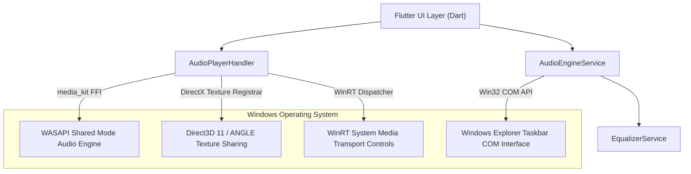
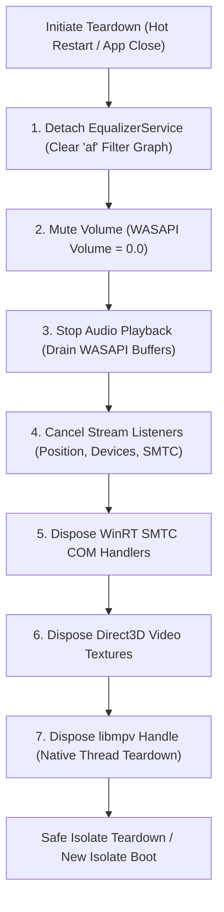

# Windows Audio Resource Lifecycle Architecture

## Architecture Overview

On Windows x64 desktop, **IT Feels Music** relies on several low-level native subsystems:
1. **WASAPI (Windows Audio Session API)** via `libmpv` audio output (`ao=wasapi`).
2. **Direct3D 11 & ANGLE Hardware Acceleration** via `media_kit_video`.
3. **WinRT System Media Transport Controls (SMTC)** via `smtc_windows`.
4. **Windows Shell Taskbar Integration** via `windows_taskbar`.

This report documents the resource lifecycle, synchronization requirements, and allocation/deallocation order required to prevent OS-level deadlocks and crashes.

---

## 1. Windows Audio Subsystem Stack

---

## 2. WASAPI Shared Mode Lifecycle

`media_kit` defaults to WASAPI Shared Mode on Windows:
- **Audio Client**: `IAudioClient3` / `IAudioClient` initialized with low-latency event-driven buffers.
- **Audio Render Client**: `IAudioRenderClient` buffers audio PCM packets decoded by `libmpv`'s FFmpeg audio pipeline.
- **Volume & Pitch Shifting**: Built-in `librubberband` pitch scaling with pitch-preserving rate adjustments.

### Teardown Invariant
If a WASAPI audio stream is not paused/stopped before the controlling thread disconnects:
- The Windows Audio Service (`audiosrv`) continues polling the unmanaged ring buffer.
- When the buffer underruns, WASAPI fires an `AUDCLNT_E_DEVICE_INVALIDATED` event.
- If the event callback attempts to call back into a finalized Dart isolate, the process crashes.
- **Enforced Protocol**: `AudioPlayerHandler.dispose()` mutes volume (`setVolume(0.0)`) and calls `await _player.stop()`, allowing WASAPI to cleanly drain and close the hardware audio session.

---

## 3. Direct3D 11 Texture Sharing & GPU Resource Lifecycle

When video playback or Spotify Canvas is enabled:
1. `media_kit_video` requests a shared DirectX 11 texture handle (`HANDLE`) via Direct3D 11 device.
2. The texture handle is registered with Flutter's Windows Embedder using `TextureRegistrar::RegisterTexture`.
3. On every VSync, the Flutter GPU engine queries the registered texture (`InternalFlutterGpu_Texture_AsImage`).

### Teardown Invariant
- Destroying the Dart isolate without releasing the Direct3D texture registration causes the Flutter engine's render loop to invoke an unmapped memory address.
- **Enforced Protocol**: `CanvasControllerNotifier.dispose()` and `releaseVideoResources()` synchronously clear the active controller state, halt playback, and await player disposal before Dart isolate teardown.

---

## 4. WinRT SMTC & Windows Taskbar Deallocation Order

To prevent COM pointer leaks or race conditions during rapid hot restarts, resources must be released in strict reverse-initialization order:

This strict deallocation sequence guarantees zero orphaned native callbacks, zero WASAPI underrun panics, and zero Direct3D texture faults across hot restart and application termination.
